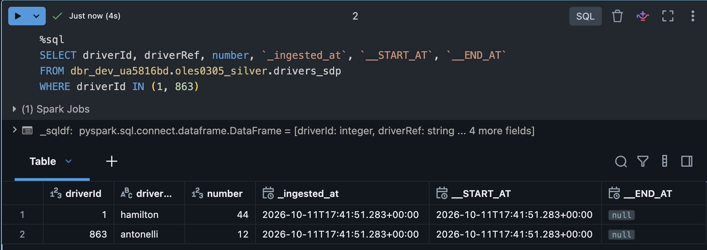
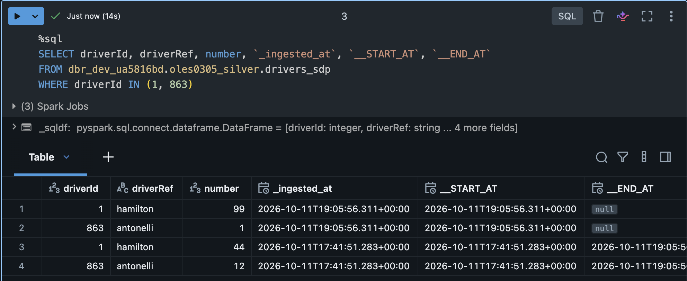
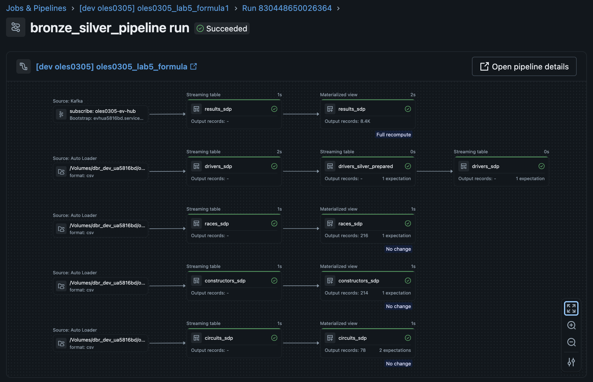

# Lab 5 - Declarative Pipelines / Lakeflow

### 1. Data Generation & Ingestion (Bronze Layer)
- **Local Producer:** A Python script (`scripts/results_producer.py`) acts as a local data generator, simulating real-time F1 race results and pushing it to an Azure Event Hubs topic.

- **Streaming Ingestion** (`bronze_streaming_sdp.py`): Captures the continuous JSON payloads from Event Hubs using Spark Structured Streaming.

- **Batch Ingestion** (`bronze_batch_sdp.py`): Loads static or slowly changing reference data (circuits, constructors, drivers and races) from ADLS using Auto Loader.


### 2. SCD Type 2 Implementation and Testing

To track historical changes in driver profiles (e.g., a driver changing their racing number), the pipeline utilizes the declarative `dp.create_auto_cdc_flow()` function in `silver_drivers_scd2_sdp.py`. This automatically manages validity timeframe columns (`__START_AT` and `__END_AT`).


- Test Case

For testing an incremental test file (drivers_test_scd2.csv) was processed, where Hamilton's (`driverId=1`) race number was changed from 44 to 99, and Antonelli's (`driverId=863`) race number was changed from 12 to 1.

```csv
driverId,driverRef,number,code,forename,surname,dob,nationality,url
1,"hamilton",99,"HAM","Lewis","Hamilton","1985-01-07","British","http://en.wikipedia.org/wiki/Lewis_Hamilton"
863,"antonelli",1,"ANT","Andrea Kimi","Antonelli","2006-08-25","Italian","https://en.wikipedia.org/wiki/Andrea_Kimi_Antonelli"
```

- Before:



- After:




### 3. Pipeline DAG


The Job and Pipeline are deployed throug Databricks Asset Bundle to the trial workspace.

---

### Difference between Declarative and Classic Spark pipelines

- **Primary focus:** In Classic (Imperative) Spark pipelines we define **how** to process data, write and execute step-by-step, while in Declarative pipelines we define **what** datasets we need, and the engine handles the execution.

**State Management**: 
- Classic pipelines streaming built on Spark Structured Streaming requires explicit management of checkpoints and output modes; for implementing SCD we need to write complex `MERGE INTO` statements and deduplication handling.

- In Declarative pipelines checkpointing, offset tracking, and state persistence are handled internally. The engine abstracts batch and streaming semantics into Streaming Tables (exactly-once append-only incremental ingestion) and Materialized Views (incremental or full refreshes managed by the engine). SCD can be easily implementend using `create_auto_cdc_flow()` function.

**Data Quality**
- Imperative: Enforcing data quality requires writing manual filter checks. Handling failed rows requires custom logic.

- Declarative: Data quality rules are first-class constructs: "expectations" defined alongside table definitions, where we specify constraints and actions declaratively (Warn, Drop, Fail).

---
Declarative pipelines simplify operations much by automating DAG orchestration, streaming checkpoints, data quality enforcement and routine table maintenance out of the box. 

In contrast, classic Spark offers more flexibility, granting low-level control over things like execution plans or cluster tuning. 

From an infrastructure cost perspective, managed declarative runtimes carry a higher unit compute charge and can become expensive if left running continuously rather than on a triggered schedule. However, that premium often lowers TCO by reducing engineering hours spent on custom code, debugging, and pipeline monitoring.