# Lab 6 - Gold Layer & Business Analytics
---

## 1. Star Schema

The model has one fact table and four dimensions. Every foreign key in the fact table has the same name as the primary key of its dimension.

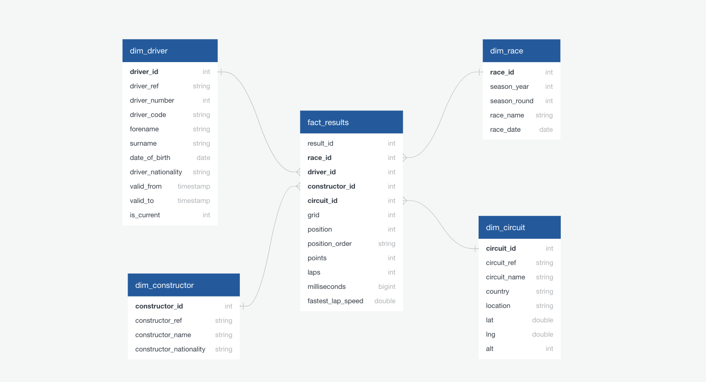

Facts grain: one row per driver per race.

Key decisions:
- Pit lane starts. In the source, grid = 0 means a pit lane start. In Gold it is replaced with the slot after the last grid position of the same race.
- No date dimension. Races are rare events, and dim_race already has season_year, round and race_date.

---
## 2. Gold Tables

| Table | Type | Grain | Main content |
|---|---|---|---|
| `fact_results` | Fact | driver × race | grid, position, points, laps, time |
| `dim_race` | Dimension | race | season, round, name, date |
| `dim_circuit` | Dimension | circuit | name, location, country, coordinates |
| `dim_driver` | Dimension | driver | name, code, nationality, date of birth |
| `dim_constructor` | Dimension | constructor | name, nationality |
| `agg_driver_season` | Aggregate | driver × season | races, wins, podiums, points, grid and position sums |
| `agg_constructor_season` | Aggregate | constructor × season | races, wins, podiums, points |
| `agg_driver_circuit` | Aggregate | driver × circuit | races, wins, podiums, points, grid and position sums |

Service tables:
- `access_roles`: user roles for RLS and CLS.
- `data_volume_log`: row counts after each Gold build, used by the alert.

---
## 3. Dashboard

Dashboard F1 Performance has three pages.

- ### Season Overview
Filter by Season.
KPI counters, Drivers’ Championship table, Constructors’ Championship bar chart, cumulative points by round

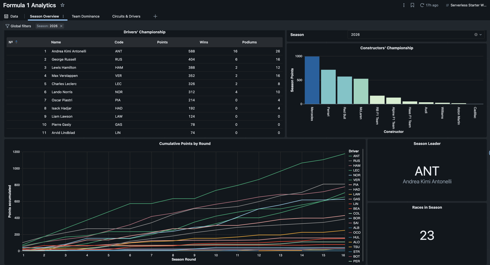

- ### Team Dominance
Filter by Seasons.
Team wins heatmap, share of season points by team, top 10 constructors by wins

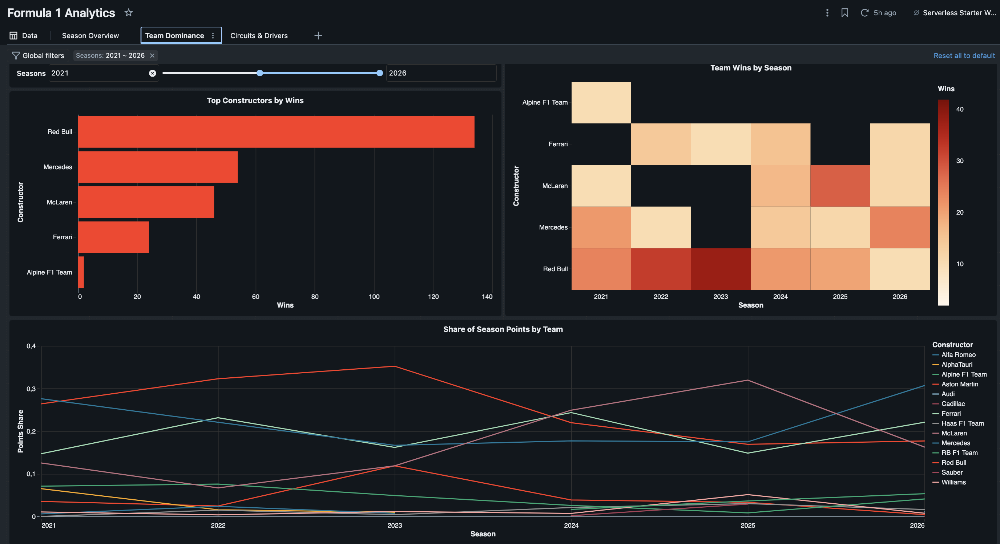

- ### Circuits & Drivers
Filters by Country, Circuit.
Circuits map, top drivers at a circuit, average grid vs. average finish scatter plot

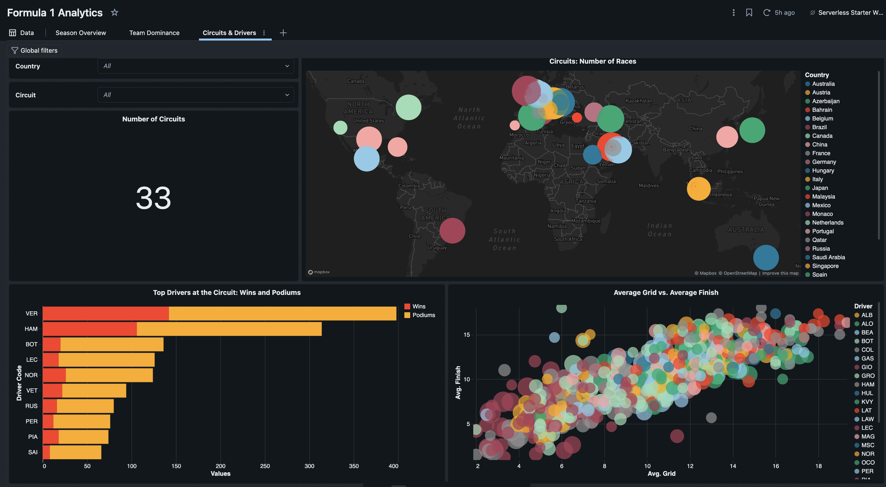
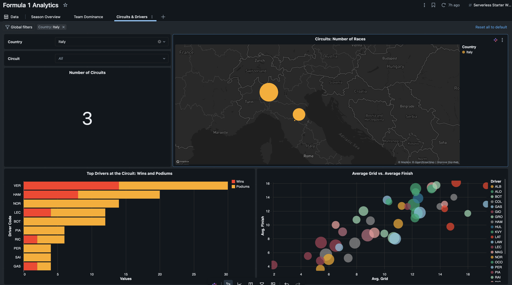

---
## 4. Governance: Grants, RLS and CLS
#### Roles

Roles are stored in `access_roles` (one row per user):

| user_email | role | constructor_id |
|---|---|---|
| admin user | `admin` |	NULL
| test user | `analyst`/`constructor_viewer` | NULL / constructor id

For the demo, one user switches roles by updating their own row. A user who is not in the table sees no rows (deny by default).

What each role sees
| Role | Rows | date_of_birth |
|---|---|---|
|`admin` |	all|	full date
|`analyst` |	all|	year only (01 Jan)
|`constructor_viewer` |	only own constructor | year only (01 Jan)

#### Implementation:
- **RLS (row filter)** on fact_results and agg_constructor_season: by constructor_id.
- **CLS (column mask)** on dim_driver.date_of_birth: full date for admin, year only for others.

#### Test Results:

- `admin`
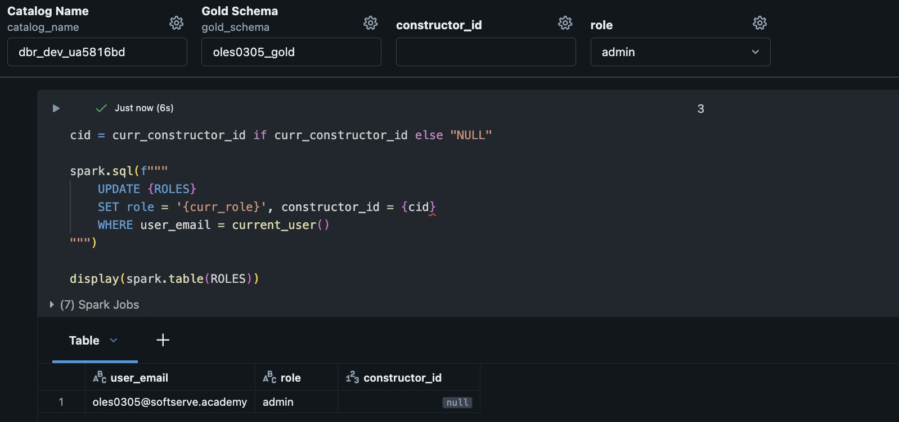
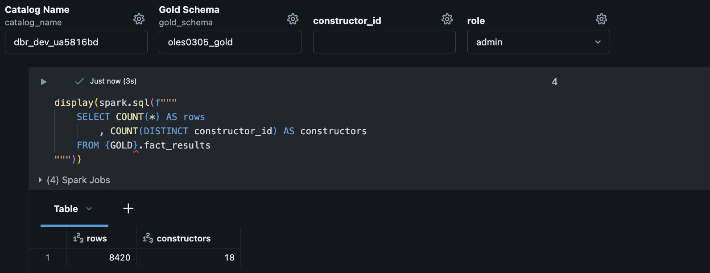
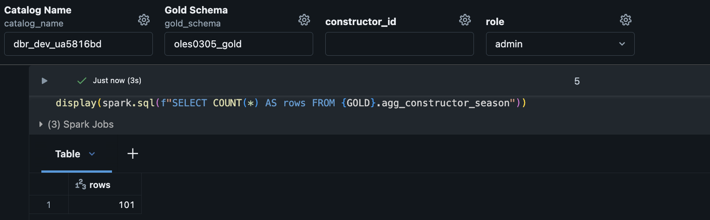
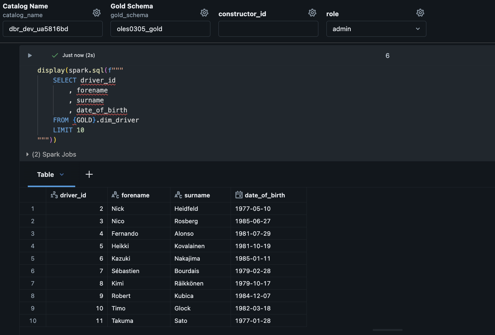

- `analyst`
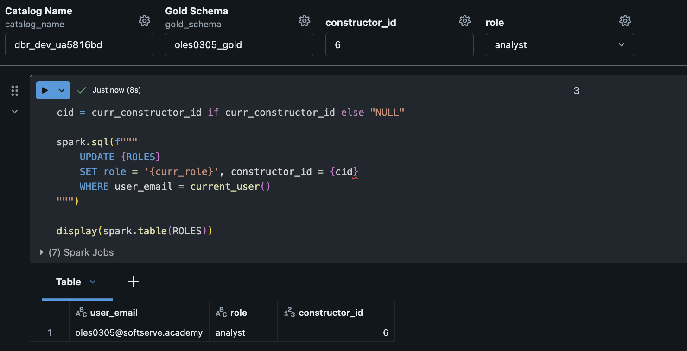
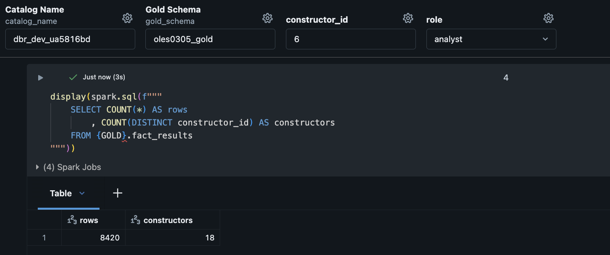
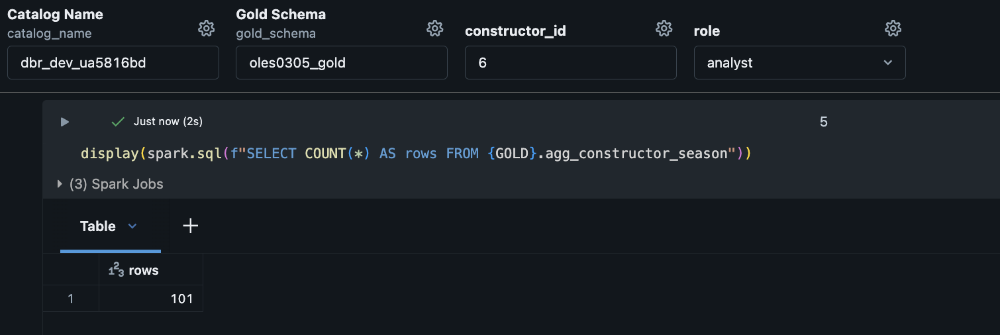
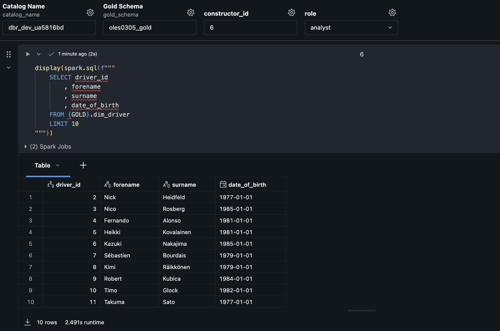

- `constructor viewer` (constructor_id=6)
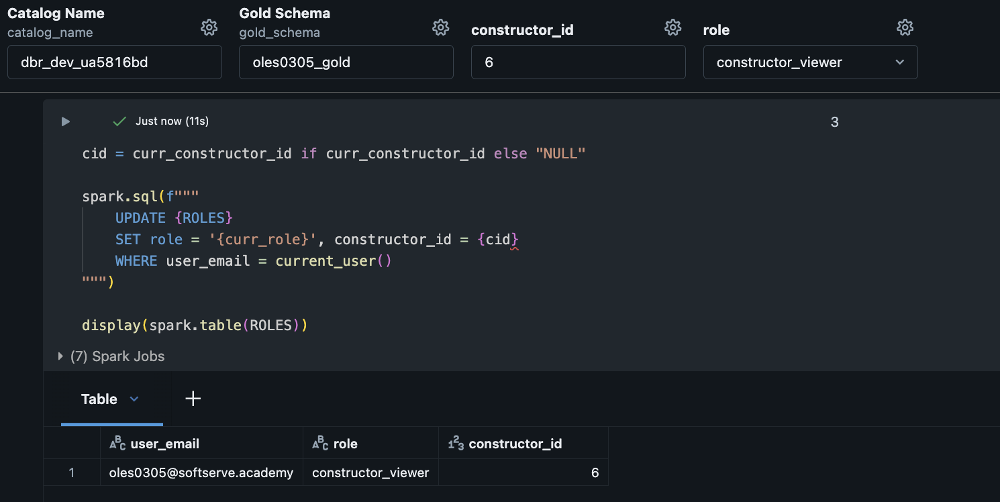
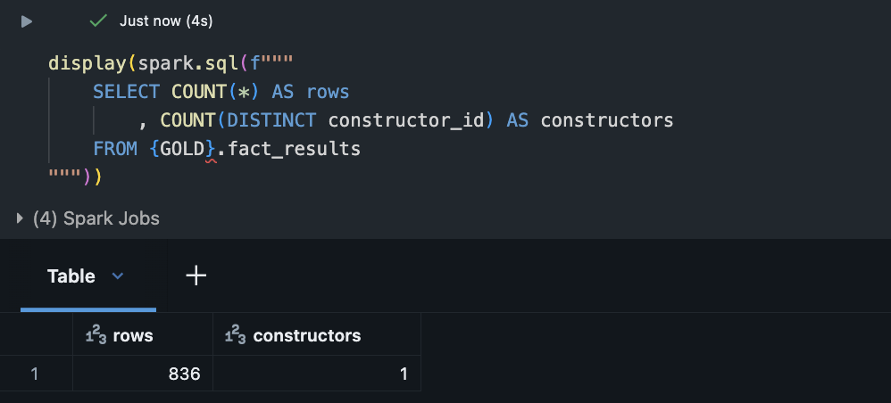
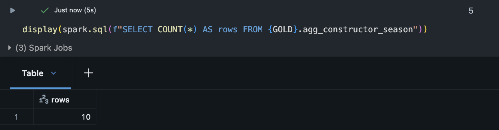
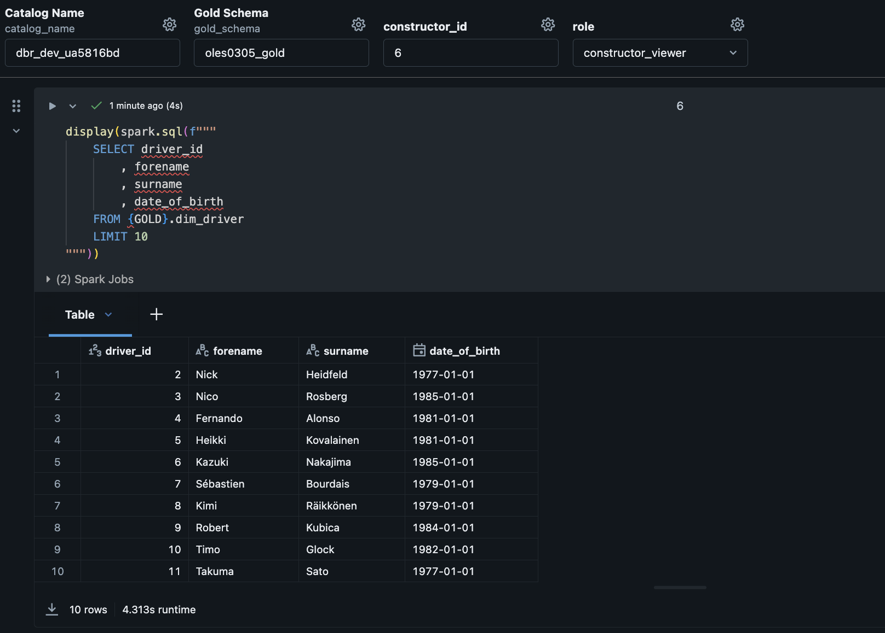

---
## 5. Alert

The alert checks for a drop in data volume.

- **Source:** `data_volume_log`, where row counts are saved after each Gold build.
- **Metric:** percent change of fact_results rows compared to the previous run.
- **Condition:** change is below -20%.
- **Notification:** email.

#### Simulation: 
A fake row with a lower row count was added to the log. The alert changed to Triggered and sent an email. After the fake row was removed, the alert returned to OK.

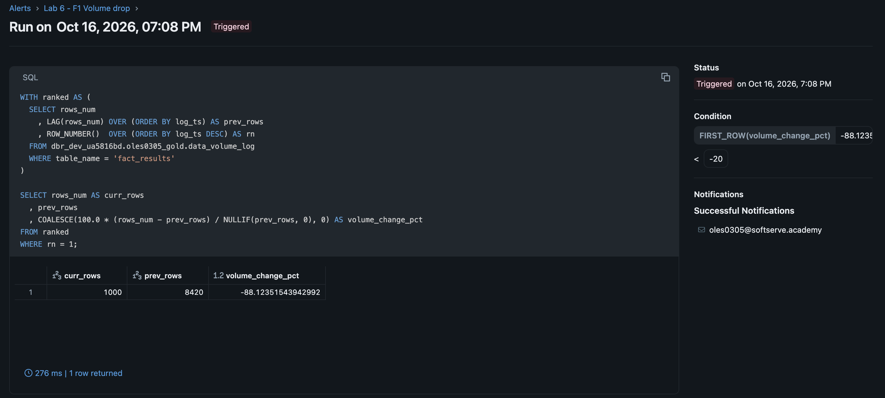

---
## 6. Genie Space

The Genie space "Formula 1 Racing Analytics" answers questions in natural language over the Gold layer.

Tables: the 5 star schema tables and the 3 aggregates. Service tables are not included.

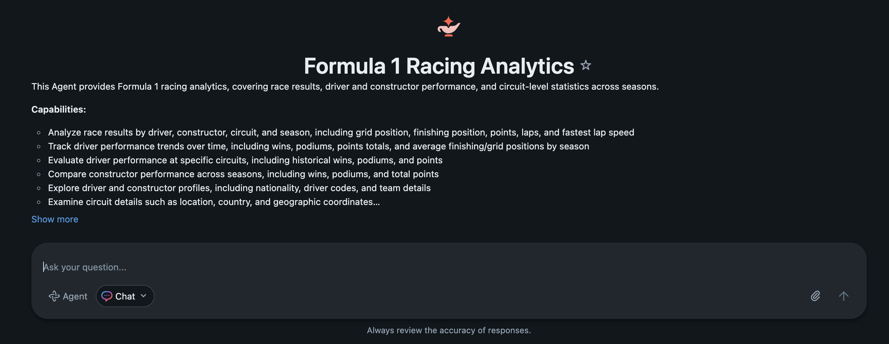
Q&A Example:
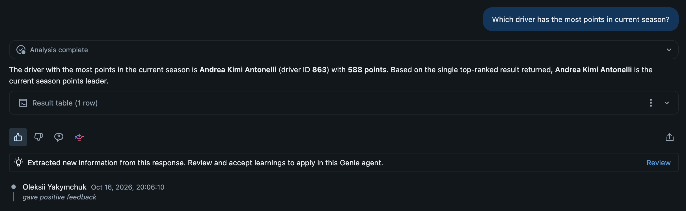

