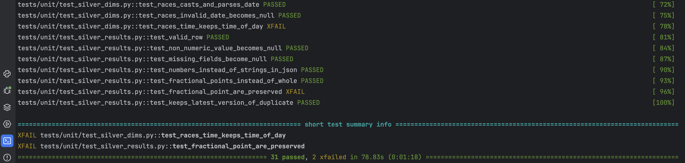
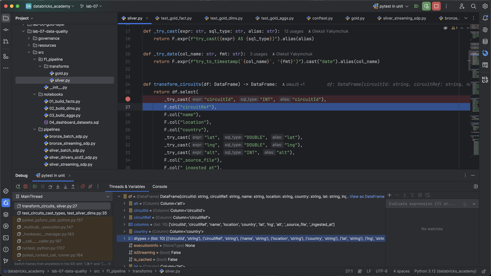
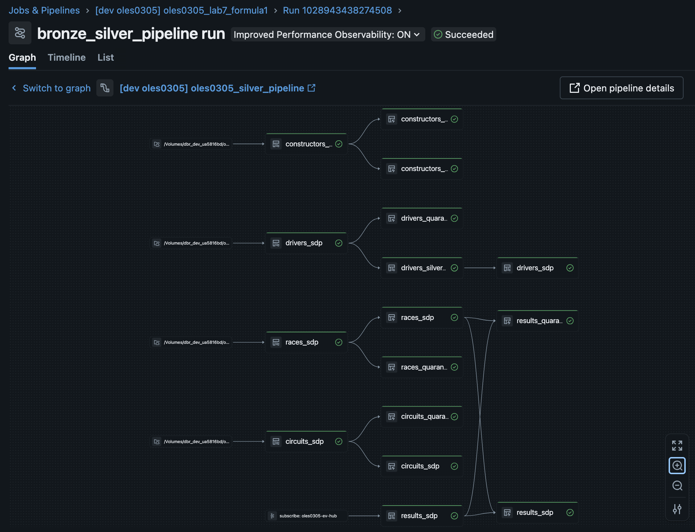
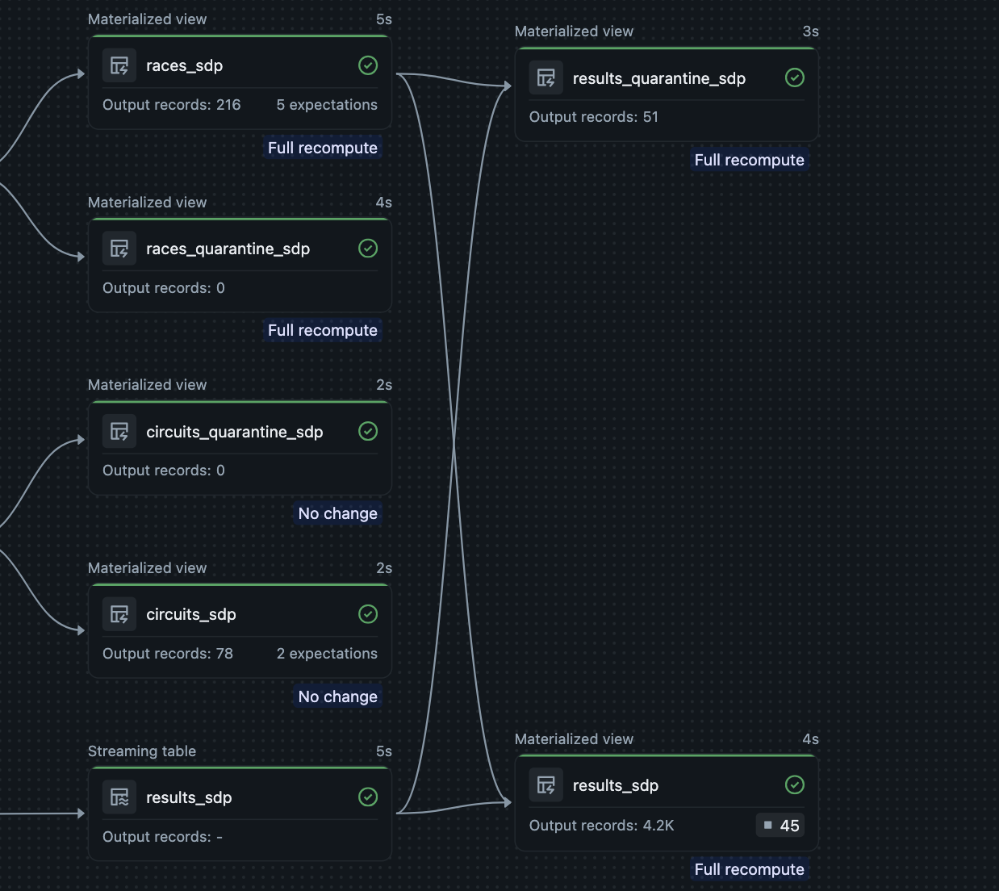
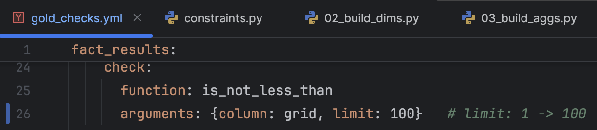
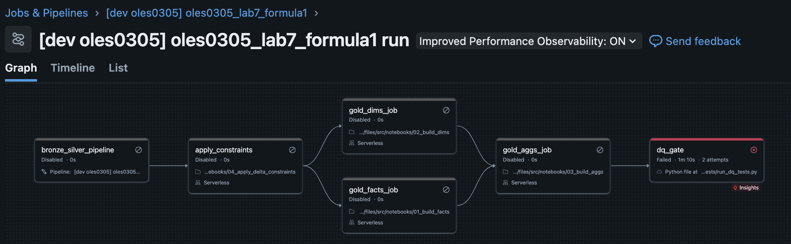
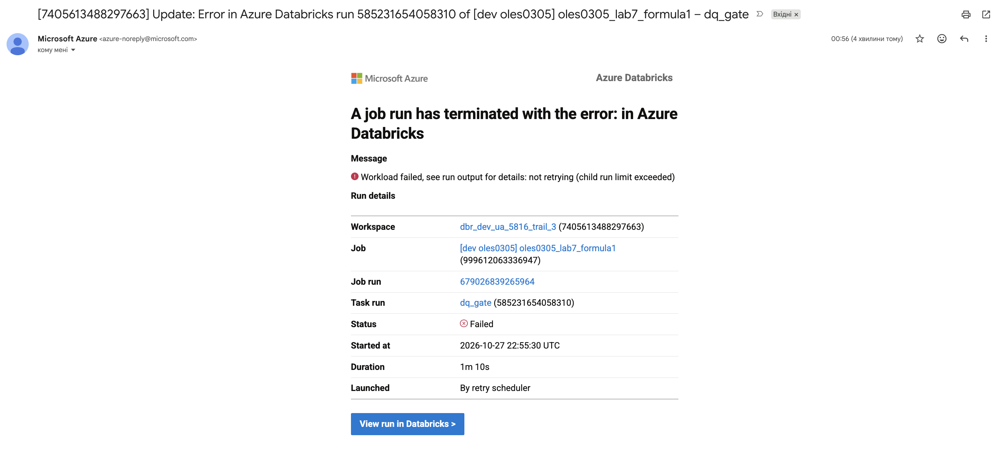

# Lab 7 — Data Quality Testing & Unit Tests

## Overview

This lab adds tests to the Formula 1 medallion from Lab 6. Unit tests check the transformation code.
Data quality (DQ) tests check the data in every layer. The last task of the job, `dq_gate`, fails when
a DQ check fails, and an email is sent.

Catalog: `dbr_dev_ua5816bd`. Schemas: `oles0305_bronze`, `oles0305_silver`, `oles0305_gold`.
The Lab 6 bundle was destroyed first, because two pipelines cannot own the same tables.

## Architecture

```
landing volume ─▶ bronze.*_sdp ─▶ silver.*_sdp ───────────────▶ gold: fact_results, dim_race, dim_circuit,
                              └▶ silver.*_quarantine_sdp           dim_constructor, dim_driver, agg_*
```

Job `oles0305_lab7_formula1`:

```
bronze_silver_pipeline ─▶ apply_constraints ─▶ gold_facts_job ┐
                                            └▶ gold_dims_job  ┴▶ gold_aggs_job ─▶ dq_gate
```

A second job, `oles0305_lab7_unit_tests`, runs the unit tests headless.

## Project structure

| Path | Content |
|---|---|
| `src/f1_pipeline/transforms/` | Transformation functions for silver and gold |
| `src/f1_pipeline/dq/` | `rules.py` (expectation rules), `constraints.py` (Delta constraints) |
| `src/pipelines/` | Lakeflow pipeline files: bronze, silver, quarantine |
| `src/notebooks/` | Job tasks: gold build and `04_apply_delta_constraints` |
| `tests/unit/` | pytest + chispa unit tests (34 tests) |
| `tests/dq/` | DQ suite: DQX rules (`gold_checks.yml`), consistency, reconciliation |
| `resources/`, `databricks.yml` | Asset Bundle: pipeline, jobs, target `dev` |
| `../.github/workflows/lab07-ci.yml` | CI: unit tests |

## Part A — Unit tests

The transformation logic lives in the `f1_pipeline` package, not in notebook cells.
Notebooks and pipeline files only read data, call the functions and write the result.
The tests cover parsing, safe type casting (invalid values become `NULL`), deduplication,
silver tables, `fact_results`, dimensions, aggregations and the DQ rules.

| Where | Command |
|---|---|
| Local, against remote Spark (Databricks Connect) | `export DATABRICKS_CONFIG_PROFILE=dev_trial_3` then `pytest tests/unit` |
| Headless with the bundle | `databricks bundle run job_oles0305_lab7_unit_tests -p dev_trial_3` |
| CI | GitHub Actions, local PySpark |

Databricks Connect 17.x needs Python 3.12. The same setup works for debugging in the IDE.




## Part B — Data quality testing

### In-pipeline gates and quarantine

Rules are dictionaries in `dq/rules.py`. Silver tables use them in `expect_all_or_drop`,
and the same rules build the quarantine tables.

| Table | Main rules | Action |
|---|---|---|
| `results_sdp` | ids not null, `grid >= 0`, `points >= 0`, `position >= 1`, `laps >= 0`, race exists | drop |
| `races_sdp` | ids not null, year 1950 to now, `round >= 1`, date not null | drop |
| `circuits_sdp`, `constructors_sdp`, `drivers_sdp` | key (and name) not null | drop |
| `circuits_sdp` | coordinates in valid range | warn only |

Every silver table has a quarantine table (`results_quarantine_sdp`, `races_quarantine_sdp`, and so on).
A row goes there when it breaks a drop rule, and the column `_failed_rules` lists the broken rules.
For `results`: bronze 4216 rows = silver 4165 + quarantine 51. Six of the quarantined rows point to
races that do not exist in the source data.




### Delta constraints

`dq/constraints.py` defines `NOT NULL` and `CHECK` constraints for every gold table
(for example `points >= 0`, `wins <= races_count`, `is_current IN (0, 1)`).
The task `apply_constraints` adds them before the gold build, so the table itself rejects invalid writes.


### Data quality suite

`dq_gate` runs `tests/dq` with pytest.

| Dimension | Checks | File |
|---|---|---|
| Completeness | `is_not_null` on keys, `grid`, `points` | `gold_checks.yml` |
| Uniqueness | `is_unique` on result, race, driver and dimension keys | `gold_checks.yml` |
| Validity | `grid >= 1`, `points >= 0`, `is_current` in (0, 1), latitude/longitude, `wins <= races_count` | `gold_checks.yml` |
| Consistency | no orphan keys in `fact_results`; one active record per driver | `test_consistency.py` |
| Timeliness | newest bronze record is not older than 14 days | `test_consistency.py` |
| Reconciliation | bronze = silver + quarantine; silver = gold; aggregates = `fact_results` | `test_reconcilliation.py` |

Rules are written in YAML and run with DQX.
`error` rules fail the test; `warn` rules only report. Reconciliation found six rows counted twice
(in silver and in quarantine), which led to the `race_exists` rule.

### Proof that the gate works

I changed one rule on purpose (`grid` must be at least 100). `dq_gate` failed, the job stopped
and I received an email. Then I restored the rule.





## CI

The workflow `.github/workflows/lab07-ci.yml` runs `pytest tests/unit` on local PySpark (Java 17, Python 3.12)
for pull requests and pushes that change `lab-07-data-quality/`. 
