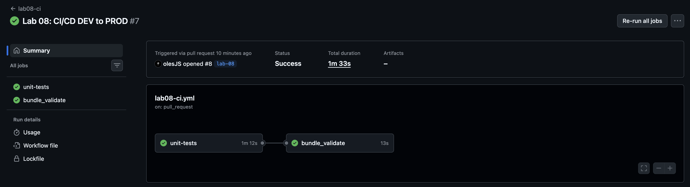
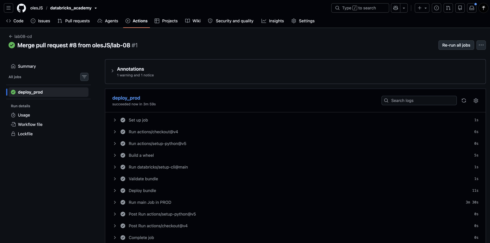
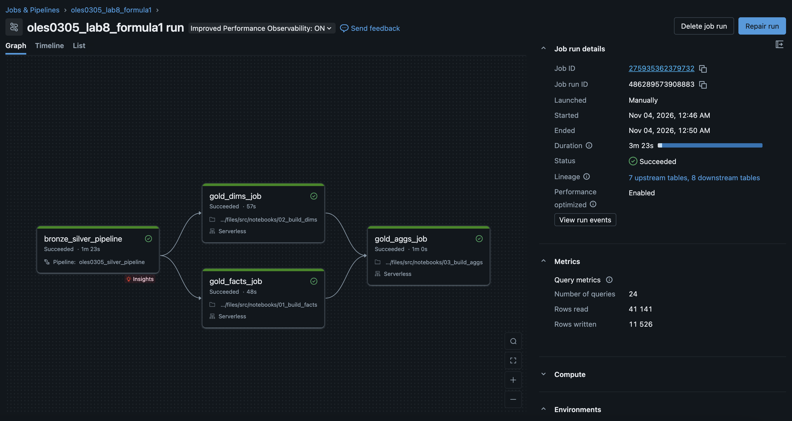
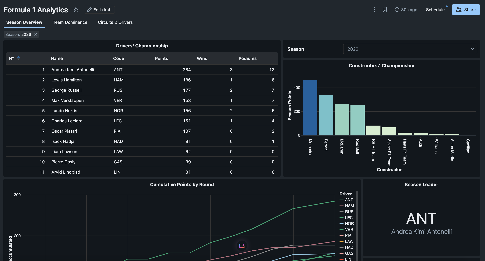
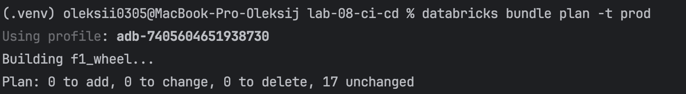

# Lab 8 - CI/CD: DEV → PROD Promotion


## Environments

Both targets use the workspace `dbr_dev` and the catalog `dbr_dev_ua5816bd`. They are kept apart by schema, resource name and bundle path.

| | `dev` | `prod` |
|---|---|---|
| Bundle mode | `development` | `production` |
| Schemas | `oles0305`, `_bronze`, `_silver`, `_gold` | `oles0305_prod`, `_bronze`, `_silver`, `_gold` (created by the bundle) |
| Resource names | prefix `[dev oles0305]` | no prefix |
| Bundle path | `/Workspace/Users/<user>/.bundle/.../dev` | `/Workspace/Users/<SP>/.bundle/.../prod` |
| Landing volume | existing external volume | external volume `oles0305_prod.landing` (created by the bundle) |
| Runs as | deploying user | deploying user (see Limitations) |

All environment-specific values (catalog, schema, Event Hub, secret scope, warehouse, reader group) are bundle variables set per target. The code reads them from job parameters, notebook widgets and pipeline configuration, so there are no hard-coded names.

## Project structure

| Path                                  | Content |
|---------------------------------------|---|
| `databricks.yml`                      | Bundle: variables, wheel artifact, targets `dev` and `prod` |
| `resources/`                          | Pipeline, main job, DQ job, dashboard |
| `src/f1_pipeline/`                    | Python package (transforms, DQ rules), built into a wheel |
| `src/pipelines/`, `src/notebooks/`    | Lakeflow pipeline files and gold-layer notebooks |
| `src/formula_1_analytics.lvdash.json` | Dashboard with its datasets and queries |
| `tests/unit/`, `tests/dq/`            | Unit tests (CI) and DQX data-quality tests (separate job) |
| `../infra/`                           | Terraform: creates the PROD landing folder in ADLS |
| `../.github/workflows/`               | `lab08-ci.yml`, `lab08-cd.yml` |

## CI/CD

```
pull request ─▶ lab08-ci:  unit tests ─▶ bundle validate (DEV)
merge to master ─▶ lab08-cd:  bundle validate ─▶ bundle deploy ─▶ run main job (PROD)
```

Unit tests are the only test gate. DQX checks are a separate job (`oles0305_lab08_dq_checks`) and are not part of CI/CD.

Deployments are idempotent: a second `bundle deploy -t prod` without changes changes nothing (see screenshot).

Concurrent PROD deployments are blocked with a workflow `concurrency` group.

## Promoted as code

Pipeline, main job, DQ job, notebooks, wheel, schemas, external volume, dashboard (datasets and queries), job/pipeline/dashboard permissions, and `grants` on the PROD schemas.

## Terraform

`infra/` creates the folder `oles0305-prod/landing` in the existing ADLS container, which backs the PROD external volume.

## Known limitations

- **One workspace for both targets.** There is no separate PROD workspace (the trial workspaces expired), so `dev` and `prod` share `dbr_dev` and are isolated by schemas, name prefix and bundle path.
- **`run_as` is the deploying user, CI authenticates with a PAT.** The service principal `sp-databricks-adls` is prepared (`run_as`, paths and permissions are in the config), but the user has no `servicePrincipal.user` role on it.

## Screenshots


**Pull request checks:**


**CD run after merge:**


**PROD job run (green):**


**PROD dashboard:**


**Second deployment: `bundle plan` reports 0 changes:**

