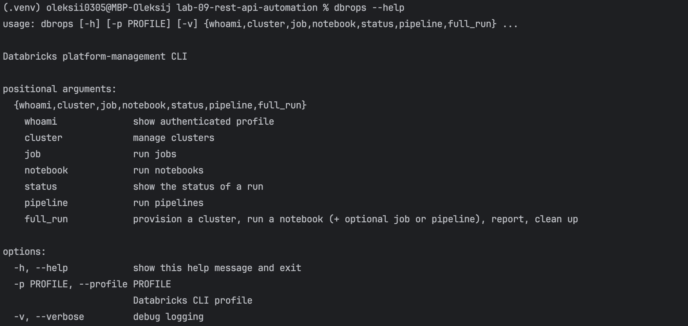
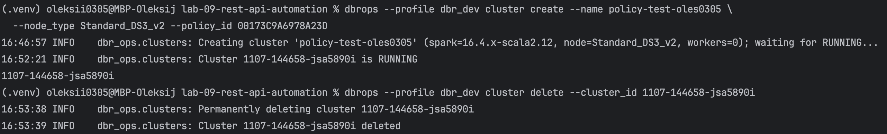
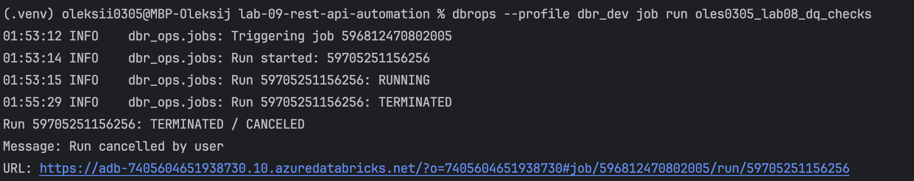
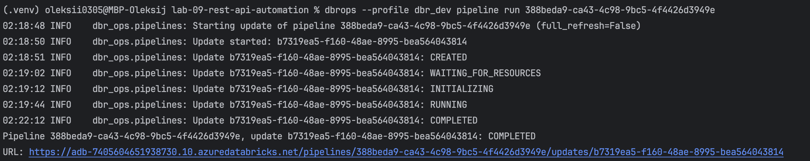
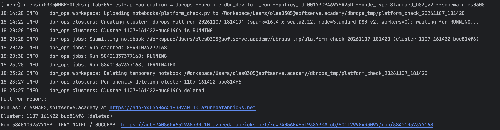
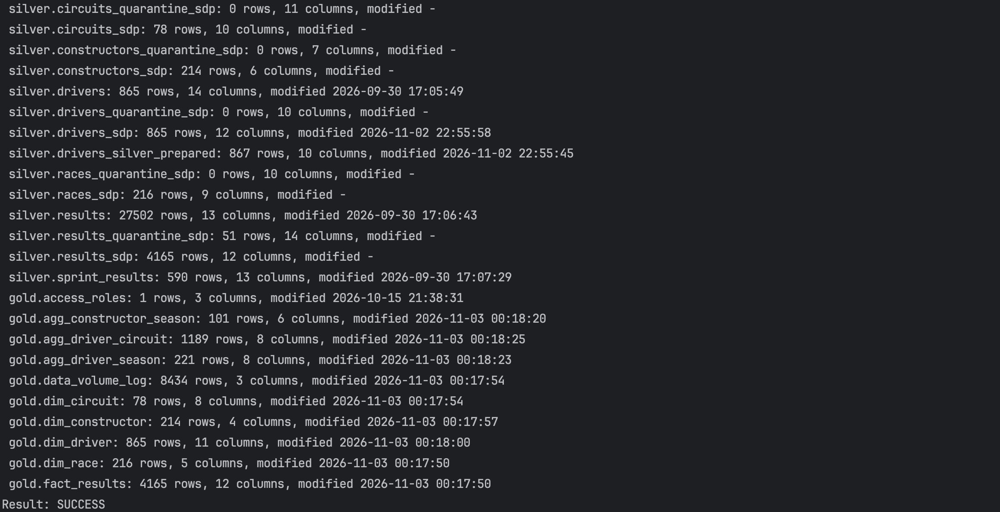
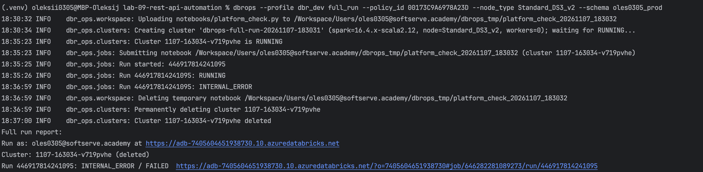
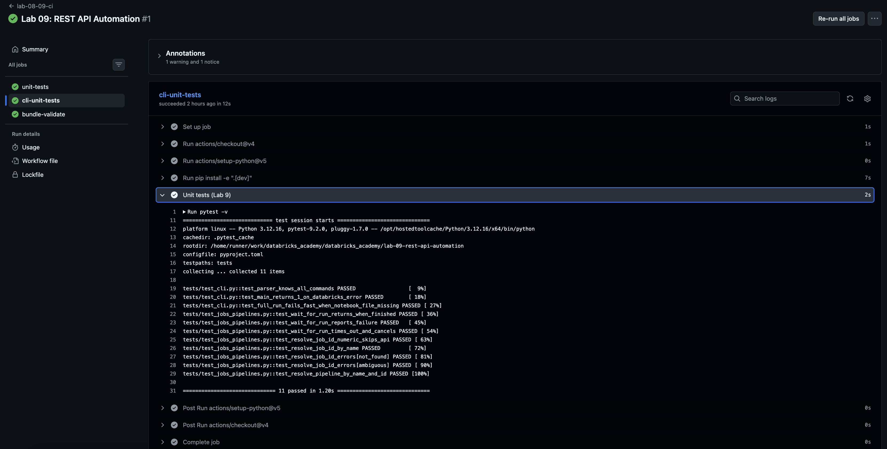
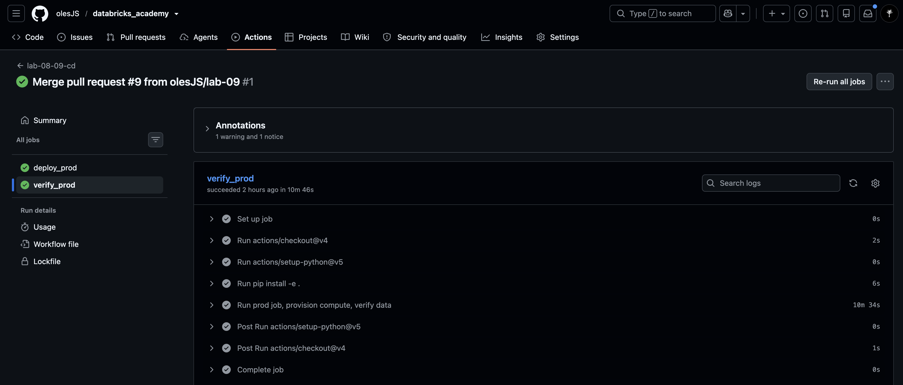
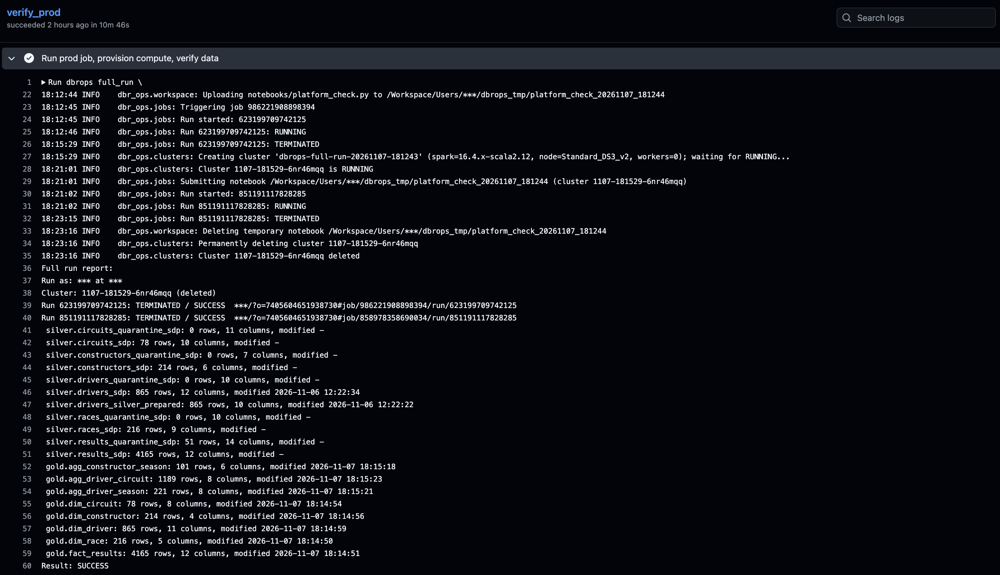

# Lab 9 - Databricks REST API Automation

## Overview

`dbrops` is a command-line tool built with the Databricks Python SDK and argparse. It creates clusters, runs jobs, notebooks and pipelines, and reports their status. It is part of the CI/CD flow from Week 8.

## Commands

| Command | Purpose | Python SDK | REST API |
|---|---|---|---|
| `whoami` | Show the current user and workspace | `current_user.me()` | `GET /api/2.0/preview/scim/v2/Me` |
| `cluster create` | Create a cluster, wait for `RUNNING` | `clusters.create_and_wait()` | `POST /api/2.1/clusters/create` |
| `cluster delete` | Delete a cluster | `clusters.permanent_delete()` | `POST /api/2.1/clusters/permanent-delete` |
| `job run` | Trigger a job, wait for the result | `jobs.run_now()`, `jobs.get_run()` | `POST /api/2.2/jobs/run-now`, `GET /api/2.2/jobs/runs/get` |
| `notebook run` | Run a notebook once, wait for the result | `jobs.submit()` | `POST /api/2.2/jobs/runs/submit` |
| `pipeline run` | Start a pipeline update, wait for the result | `pipelines.start_update()`, `pipelines.get_update()` | `POST /api/2.0/pipelines/{id}/updates`, `GET /api/2.0/pipelines/{id}/updates/{update_id}` |
| `status` | Show the state of a run | `jobs.get_run()` | `GET /api/2.2/jobs/runs/get` |
| `full_run` | Full scenario (see below) | the calls above + `workspace.upload()`, `workspace.delete()` | + `POST /api/2.0/workspace/import`, `POST /api/2.0/workspace/delete` |

Common behavior: results go to stdout, logs go to stderr. Runs are polled every 10 seconds and cancelled after a timeout (30 minutes by default). Exit code is `0` on success and `1` on failure.

## Examples

Creating a cluster from a cluster policy:

Running an existing job (was manually terminated):

Running a pipeline:

## full_run scenario

1. Upload the check notebook to a temporary workspace folder.
2. Run the job (and the pipeline, if given).
3. Create a cluster from a cluster policy.
4. Run the notebook on the new cluster. It profiles all silver and gold tables (rows, nulls, size, last change) and fails if a layer has no tables or a table is empty. Quarantine tables may be empty.
5. Print a report.
6. Delete the temporary notebook and the cluster. This also happens after an error or Ctrl+C.

### Successful run:

### Failed run: the report shows the error, the exit code is 1, and the cluster is still deleted.

The service principal cannot create unrestricted clusters, so clusters are created with a cluster policy (`Can use`). The policy limits the allowed node types.

## CI/CD integration

| Stage | Workflow | What runs |
|---|---|---|
| Pull request | `lab-08-09-ci` | Lab 8 unit tests, Lab 9 CLI unit tests, bundle validation |
| Merge to `master` | `lab-08-09-cd` | `deploy_prod`, then `verify_prod` |

- `deploy_prod` validates and deploys the bundle to prod as the service principal.
- `verify_prod` installs the CLI and runs `full_run`: the prod job, a new cluster, the data check, cleanup. A non-zero exit code fails the workflow.
- Secrets: `ARM_*` and the workspace host. Policy id and node type are repository variables.

