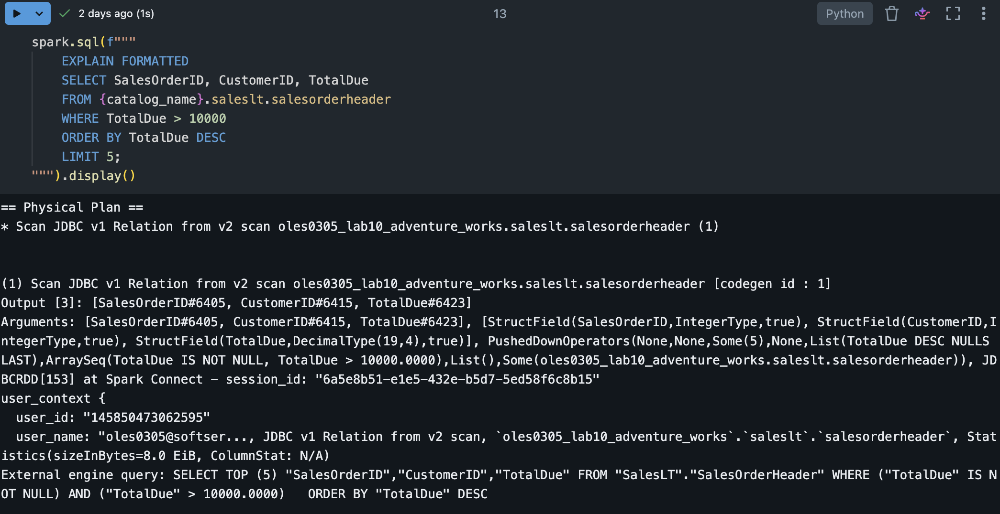
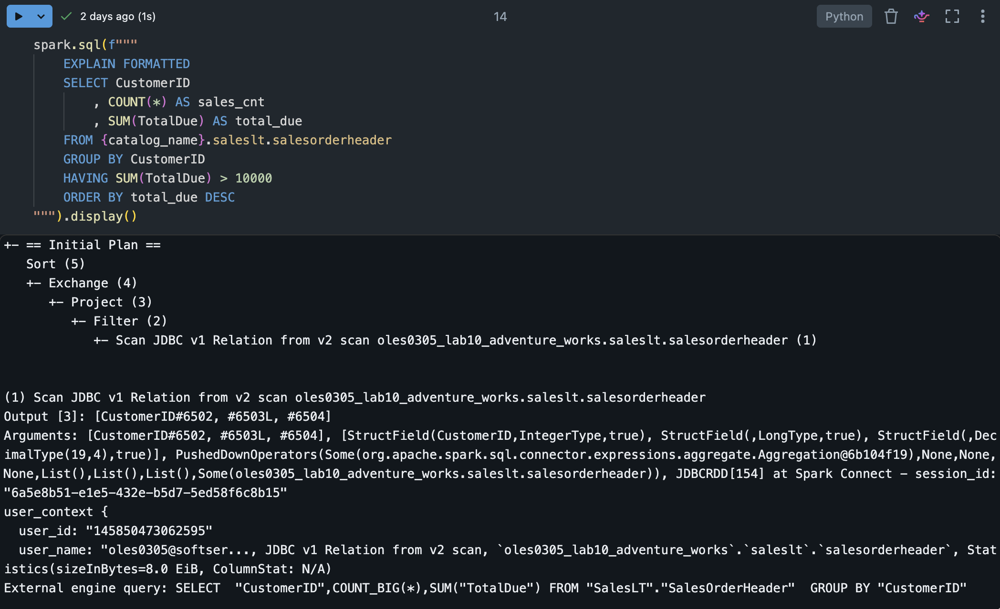
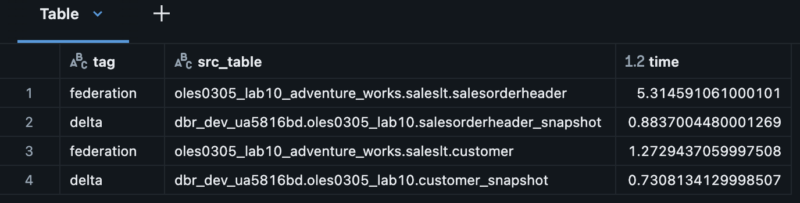
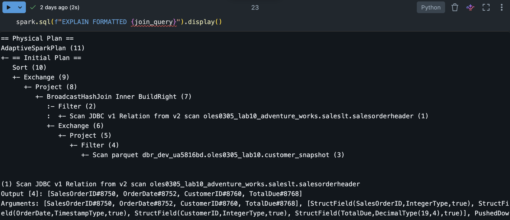
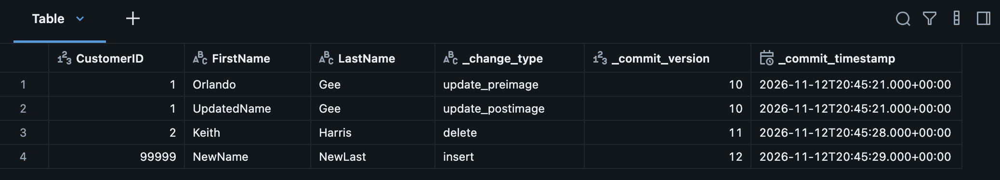
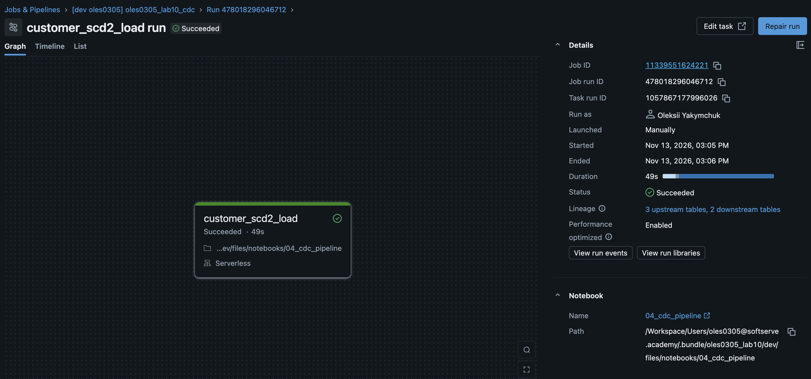

# Lab 10 - Lakehouse Federation & Change Data Capture

### Overview

- **Part A - Lakehouse Federation.** Query Azure SQL Database (AdventureWorksLT) from Databricks through a Unity Catalog foreign catalog, check query pushdown, compare federation with Delta and ingest snapshots to Delta.
- **Part B - Change Data Capture.** Capture row-level changes with Delta Change Data Feed (CDF) and apply them incrementally to an SCD Type 2 table with a MERGE INTO. The load runs as a Databricks job deployed with an asset bundle.

### Notebooks

| Path | Purpose |
|---|---|
| `notebooks/01_lakehouse_federation.py` | Connection, foreign catalog, pushdown, federation vs Delta, Delta snapshots |
| `notebooks/02_cdc_capture_demo.ipynb` | How CDF records inserts, updates and deletes (demo table) |
| `notebooks/03_cdc_setup.py` | One-time setup: CDF source, SCD2 target, watermark |
| `notebooks/04_cdc_pipeline.py` | Incremental SCD2 load (job task) |
| `notebooks/05_pipeline_demo.ipynb` | Test scenario: changes in the source and result in the target |

---
### Part A - Lakehouse Federation

- **Connection** `oles0305_sqlserver_aw` (type `sqlserver`). The user and password come from an Azure Key Vault-backed secret scope.
- **Foreign catalog** `oles0305_lab10_adventure_works` exposes the `saleslt` schema in Unity Catalog.
- **Pushdown** is checked with `EXPLAIN FORMATTED` for filter / sort / limit and for aggregation.
- **Federation vs Delta**: the same queries are timed against the foreign tables and their Delta snapshots.
- **Delta snapshots**: `customer_snapshot` and `salesorderheader_snapshot` (with `_ingested_at`) are the input for Part B.
- **Mixed join** of a foreign table with a Delta table.

#### Pushdown
 
Checked with `EXPLAIN FORMATTED`. The `External engine query` line shows the SQL that Databricks sends to Azure SQL.
 
Filter, sort and limit:
 

 
Aggregation: `GROUP BY`, `COUNT` and `SUM` are pushed down, so SQL Server returns one row per customer instead of all orders. `HAVING` and `ORDER BY` run in Spark.
 

 
#### Federation vs Delta
 
The same queries are timed against the foreign tables and their Delta snapshots.
 

 
#### Join of a foreign table with a Delta table
 
Only column pruning and the `IS NOT NULL` filter on the join key are pushed to SQL Server. The join runs in Spark as a broadcast hash join: the small Delta customer table is broadcast, orders are streamed from Azure SQL.
 

### Discussion
 
**Federation vs ingestion.** Federation queries the source in place: no copies, no pipelines, data is always current. It fits exploration, ad-hoc lookups and small reference tables. Ingestion to Delta fits regular analytics and heavy queries: data is stored in an optimized format, has history and doesn't depend on the source being online.
 
**Latency.** Every federated query goes over the network to the source and runs partly on it. Only what can be pushed down (filters, projections, simple aggregations) runs in SQL Server, the rest is transferred to Spark. Joins between sources always run in Spark. Delta snapshots are faster for repeated queries but are only as fresh as the last load.
 

---
## Part B - Change Data Capture

### How CDF captures changes

With `delta.enableChangeDataFeed = true` every commit records row-level changes. They are read with `readChangeFeed` and have the extra columns `_change_type`, `_commit_version`, `_commit_timestamp`. An update produces two rows: `update_preimage` and `update_postimage`.

### Tables

| Table | Role |
|---|---|
| `customer_src` | CDC source, created from `customer_snapshot`, CDF enabled |
| `customer_scd2` | SCD2 target: `CustomerID, FirstName, LastName, CompanyName, EmailAddress, valid_from, valid_to`. Current version: `valid_to IS NULL` |
| `cdc_watermark` | Last processed source version (`source_table`, `last_version`) |

### Pipeline (`04_cdc_pipeline.py`)

1. Read `last_version` from the watermark and the current source version from `DESCRIBE HISTORY`. If they are equal, exit with `No new changes`.
2. Read CDF from `last_version + 1` to `current_version`, drop `update_preimage`, keep the latest change per `CustomerID`.
3. Apply everything with one `MERGE` (one transaction). The source is a `UNION ALL` of two parts, because one matched source row can only update **or** insert, but a changed customer needs both:
   - **Part 1** (`merge_key = CustomerID`): closes the current version on delete or a real change; inserts customers that are not in the target yet.
   - **Part 2** (`merge_key = NULL`, never matches): inserts the new current version for customers that already exist and really changed.
4. Update the watermark to `current_version`.

### Test scenario (`05_pipeline_demo.ipynb`)

| CustomerID | Change in source | Expected in target |
|---|---|---|
| 1 | `EmailAddress` updated | old version closed, new current version |
| 2 | `CompanyName` set to `NULL` | old version closed, new current version |
| 3 | update without real changes | no changes |
| 4 | deleted | current version closed, no new version |
| 99999 | inserted | new current version |
| 99998 | inserted and deleted before the load | not present |

### Job

`oles0305_lab10_cdc` runs `04_cdc_pipeline.py` on serverless, with `delta_catalog` and `delta_schema` passed as job parameters.

- **Trigger:** table update on `customer_src`, 60 s after the last change (paused in the `dev` target).
- **`max_concurrent_runs: 1`, no retries:** two parallel runs or a retry after a successful `MERGE` would apply the same changes twice and duplicate history.

### Discussion
 
**Batch vs CDC ingestion.** A full batch load re-reads and rewrites the whole table on every run, even if a few rows changed, and cannot see deletes without comparing full snapshots. CDC reads only the changed rows, explicitly marks inserts, updates and deletes.

**Slowly changing dimensions.** Dimension attributes change over time, and SCD types define how a table keeps those changes. Type 1 overwrites the row: simple, but history is lost. Type 2 closes the current version and adds a new one with a validity period (`valid_from` / `valid_to` or an `is_current` flag), so the state at any moment can be queried.
 
**Late-arriving data.** Changes can reach the pipeline late or out of order: a source system was offline, events were retried, or a record is loaded after newer ones. If changes are simply applied in arrival order, an older value can overwrite a newer one, and in SCD2 the validity periods become wrong. The usual fixes are to order changes by a business timestamp or sequence number rather than by arrival time, to ignore a change that is older than the current version, and in SCD2 to insert a late version into the right place in history. 