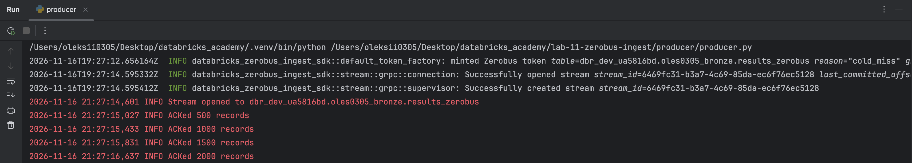
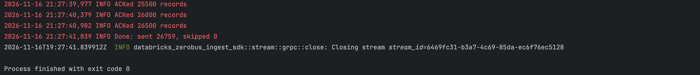
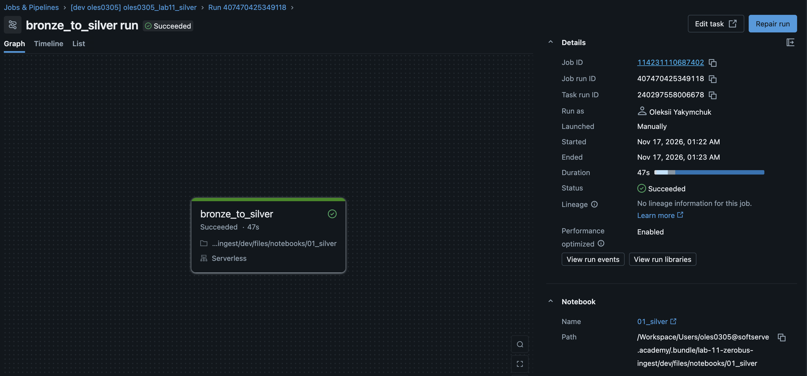
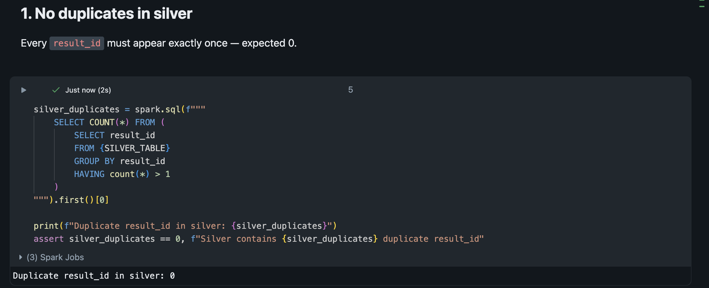
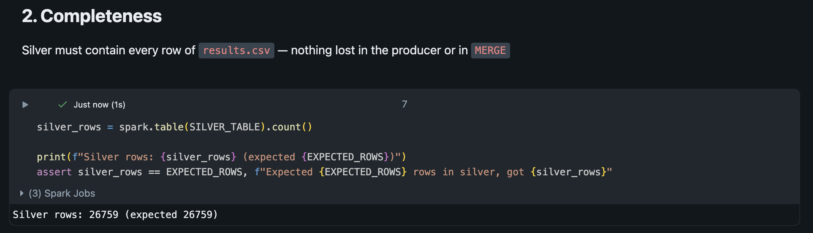
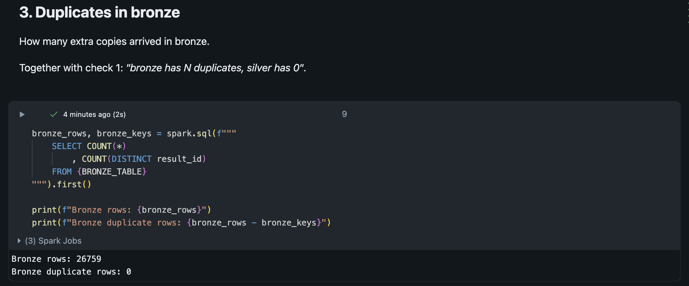
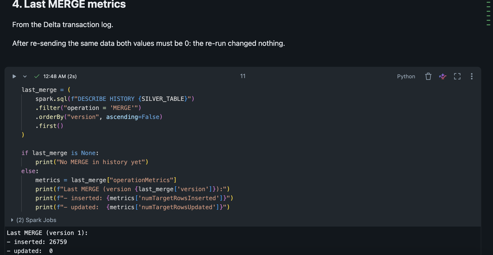
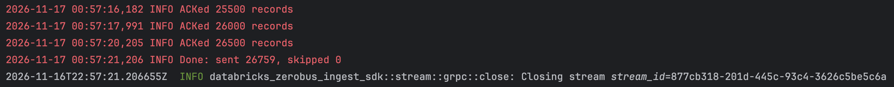
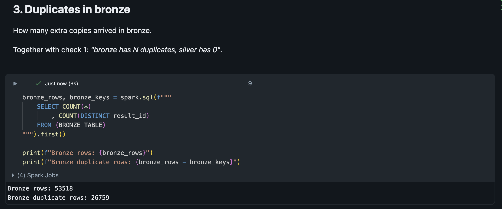
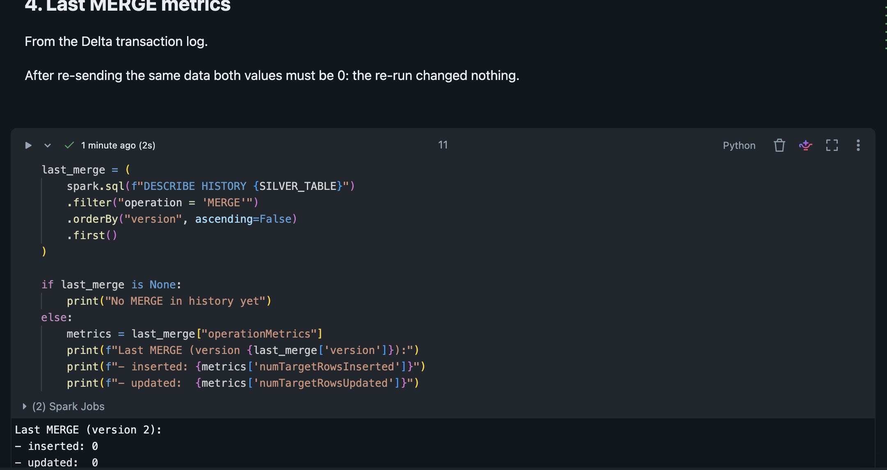

# Lab 11 - Zero-Bus Streaming with Zerobus

## Overview

A local Python producer reads Formula 1 race results (`results.csv`, 26,759 rows) and pushes every row as an event directly into a Unity Catalog Delta table through **Zerobus Ingest**. There is no message bus (Kafka, Event Hubs) between the producer and the lakehouse. A Databricks job then loads the data from bronze to silver in an idempotent way, so duplicates from re-sends never reach silver.

```
producer.py (local) ──gRPC + Protobuf──▶ Zerobus Ingest ──▶ bronze (UC Delta, append-only)
                                                               │  table update trigger
                                                               ▼
                                         job: Structured Streaming + MERGE ──▶ silver (1 row per result_id)
```

## Project structure

| Path | Content |
|---|---|
| `producer/producer.py` | Zerobus producer: CSV → Protobuf → bronze |
| `producer/config.yml` | Endpoints, target table, CSV path, batch size |
| `producer/.env.example` | Template for the service principal credentials (`.env` is not committed) |
| `proto/` | `result.proto` generated from the bronze table, compiled `result_pb2.py` |
| `notebooks/00_setup.py` | Bronze and silver tables, grants for the service principal, checkpoint volume |
| `notebooks/01_silver.py` | Bronze → silver incremental, idempotent load |
| `notebooks/02_checks.py` | Idempotency checks |
| `databricks.yml`, `resources/` | Asset Bundle with the silver job |
| `data/results.csv` | Source data ([Kaggle F1 dataset](https://www.kaggle.com/datasets/rohanrao/formula-1-world-championship-1950-2020)) |

## Producer

- Authenticates as a service principal (OAuth M2M). The principal has only `USE CATALOG`, `USE SCHEMA`, and `SELECT, MODIFY` on the bronze table.
- Uses the Zerobus Python SDK with **Protobuf**. The `.proto` schema is generated from the bronze table with `zerobus.tools.generate_proto`, so the table schema is the contract.
- Converts `\N` from the CSV to NULL. Rows with an empty NOT NULL field are skipped and logged.
- Adds technical columns `_source_file` and `_produced_at`.
- Waits for the server ACK every 500 records (`batch_size`). ACKs are ordered, so one ACK confirms the whole batch. Transient errors are handled by the SDK recovery; non-retriable errors (schema, permissions) stop the producer.
- Configuration is in `config.yml`, secrets in `.env`.


**First run — all 26,759 records are sent and acknowledged:**




## Bronze → silver

Zerobus guarantees **at-least-once** delivery, and the producer can be run again with the same file. So bronze is append-only and may contain duplicates. Silver must contain exactly one row per `result_id`.

`01_silver.py` reads bronze with Structured Streaming (`readStream.table`, `trigger(availableNow=True)`) and processes each micro-batch in `foreachBatch`:

1. **Deduplicate inside the batch** — `row_number()` over `result_id`, the latest `_produced_at` wins.
2. **Compute `_row_hash`** — SHA-256 of the business columns (`to_json(struct(...))`, so NULLs do not collide).
3. **`MERGE INTO` silver on `result_id`:**
   - new key → insert;
   - existing key, newer record **and** different hash → update;
   - otherwise → nothing.


Expected `MERGE` result:

| Scenario | inserted | updated |
|---|---|---|
| First load | 26,759 | 0 |
| Same CSV sent again | 0 | 0 |
| One value changed in the source | 0 | 1 |

## Job 

The silver job (`resources/lab11_silver_job.yml`) runs `01_silver.py` on serverless compute.

- **Table update trigger** on bronze with `wait_after_last_change_seconds: 60`: the job starts when the producer has finished writing. This makes the pipeline event-driven without a scheduler. In the `dev` target the trigger is deployed as `PAUSED`.
- `max_concurrent_runs: 1`, because two runs must not share one checkpoint.
- The producer runs outside Databricks, and the checks are a separate concern, so they are not part of this job.




## Idempotency checks

`02_checks.py` runs four checks. Checks 1 and 2 use `assert`, so the notebook fails if they do not hold.

1. No duplicate `result_id` in silver.
2. Silver has all 26,759 rows.
3. Number of duplicates in bronze.
4. `inserted` / `updated` of the last `MERGE` from `DESCRIBE HISTORY`.

### After the first load







### After sending the same CSV again

The producer sent all 26,759 records a second time:



| Check | Result |
|---|---|
| Duplicates in silver | 0 |
| Silver rows | 26,759 |
| Bronze rows / duplicates | 53,518 / 26,759 |
| Last MERGE | inserted 0, updated 0 |

Bronze doubled, silver did not change at all. The load is idempotent.





## Kafka-style vs zero-bus

```
Kafka-style:  producer ─▶ Kafka topic ─▶ consumer (Spark / connector) ─▶ Delta
                               ├─▶ microservice
                               └─▶ other systems
Zero-bus:     producer ─▶ Zerobus Ingest ─▶ Delta
```

| | Kafka-style (message bus) | Zerobus (zero-bus) |
|---|---|---|
| Design | Multi-sink: many independent consumers read the same topic | Single-sink: one destination, the lakehouse |
| Components | Brokers, topics, partitions, consumer groups, a consumer job | Producer and a Delta table |
| Operations | Cluster sizing, retention, partition balancing, consumer lag monitoring | Serverless, nothing to run or scale |
| Cost | Brokers and the consumer job run all the time | No always-on infrastructure; compute only for downstream jobs |
| Latency to Delta | Producer → broker → consumer → Delta | One hop: the record is durable after the ACK and appears in Delta shortly after |
| Replay | Re-read the topic within retention | Re-read bronze (Delta history) or re-send from the source |
| Schema contract | Schema Registry (optional) | The Delta table schema; records that do not fit are rejected |
| Delivery | At-least-once by default, exactly-once with transactions | At-least-once |
| Lock-in | Open, any consumer | Databricks-specific (Kafka-compatible producer API exists) |

### Discussion

- **Event-driven pipelines.** Both designs are event-driven. With Zerobus, events land in bronze immediately, and the next step is driven by a table update trigger instead of a consumer that is always running.
- **Decoupled systems.** Kafka decouples producers from *many* consumers: services can read the same events at their own pace. Zerobus decouples the producer only from the lakehouse — the producer does not know about silver or the jobs, but other systems can read the events only from Delta.
- **Cost and operations.** Zerobus removes a whole layer: no brokers to size, patch, and monitor, and no ingestion job. The cost is less flexibility: no fan-out to non-lakehouse systems and no broker-side retention.
- **Delivery guarantees.** In both cases the consumer side must be idempotent. Here it is done once, in the bronze → silver `MERGE`.

**When to choose what:** Zerobus fits when the lakehouse is the only (or main) consumer — IoT, telemetry, application events for analytics. A message bus is still the better choice when several independent systems must react to the same events in real time.
