# Lab 12 - RAG Knowledge Assistant & AI-Assisted Development

A knowledge assistant that answers questions about **Formula 1** from 86 English Wikipedia articles.
- Part A: RAG pipeline on Databricks. 
- Part B: packaging and deployment with an AI coding agent.

```
Wikipedia API ─▶ UC Volume (JSON) ─Auto Loader─▶ bronze.wiki_pages
   ─chunking + MERGE─▶ silver.wiki_chunks ─Delta Sync─▶ Vector Search index
   ─▶ ask(): retrieve → LLM → answer + sources ─▶ gold.qa_log + MLflow traces
```

| Path | Content |
|---|---|
| `scripts/fetch_wiki.py` | Fetch articles, upload to UC Volume |
| `rag/` | `config.py`, `chunking.py`, `qa.py` (`retrieve()`, `ask()`) |
| `notebooks/00–05` | Setup, ingest, chunk, index, QA, evaluation |
| `eval/questions.json` | 20 answerable + 4 unanswerable questions |
| `agent/agent.py` | `ResponsesAgent` wrapper around `ask()` for Model Serving |
| `notebooks/06_log_agent.py` | Log, validate and register the agent in Unity Catalog |
| `resources/`, `databricks.yml` | Bundle: refresh job, register job, serving endpoint |
| `tests/` | Unit tests for chunking |

---

# Part A - RAG on Databricks

## 1. Data
86 Wikipedia articles: 40 drivers, 10 teams, 24 circuits, 6 seasons (2020–2025), 6 general.
`fetch_wiki.py` uploads one JSON per article revision to a Volume; `01_ingest.py` loads new files into append-only bronze with **Auto Loader**.


## 2. Cleaning and chunking
- Drop sections without content (*References*, *External links*, ...), normalize whitespace.
- Split by sections, then into ~200 and ~400-token chunks with ~15% overlap.
- Prefix every chunk with `Title > Section:` so it keeps its context.
- Metadata: `chunk_id`, `chunk_size`, `title`, `category`, `section`, `url`, `revision_id`.

`02_chunk.py` processes only new bronze rows and `MERGE`s on the deterministic `chunk_id`; stale chunks of updated articles are deleted.


## 3. Embeddings and Vector Search
- Delta Sync index with managed embeddings (`databricks-gte-large-en`, 1024 dims); chunks stay below its 512-token limit.
- TRIGGERED sync via Change Data Feed — only changed chunks are re-embedded.
- 7,576 chunks; initial sync took ~2 h (~1 row/s embedding throughput on Free Edition).


## 4. Retrieval and QA
- `retrieve()`: hybrid search (vectors + keywords), top-5, optional `category` filter.
- `ask()`: context labelled `[Title § Section]` → LLM (`temperature=0`) → answer + sources.
- Prompt rules: answer **only** from context, cite sources, otherwise reply *"I don't know based on the available articles."*
- `use_retrieval=False` — same LLM without context, used as a baseline.

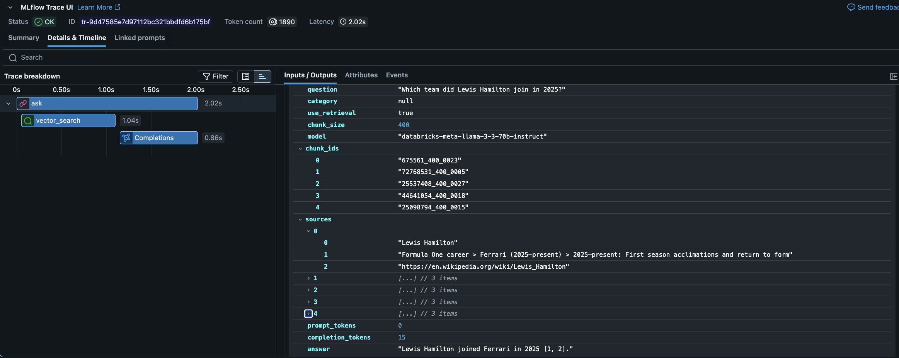


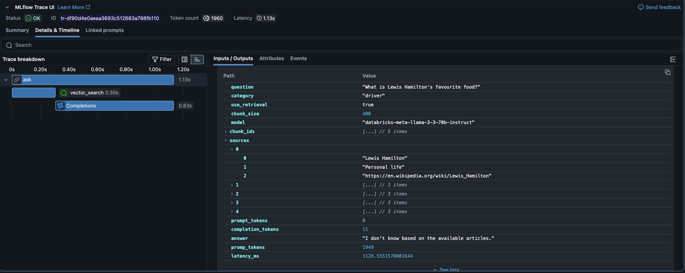

## 5. Monitoring and security
- **MLflow traces:** `ask` → `vector_search` → LLM call, with chunks, prompt, tokens, latency.
- **`gold.qa_log`:** every request (question, mode, chunk ids, answer, tokens, latency) for SQL monitoring.
- **Unity Catalog grants:** readers get `SELECT` on silver chunks and the index only; raw data and the QA log (user questions) are closed.

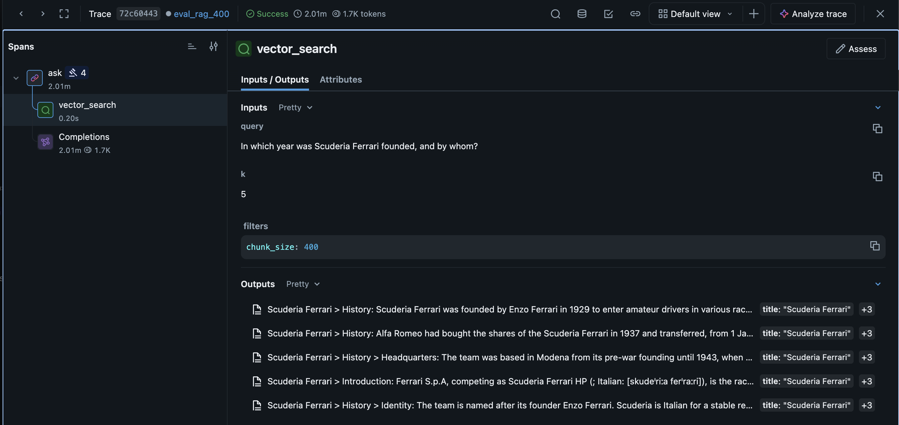


## 6. Evaluation
Three configs — `no_rag`, `rag_200`, `rag_400` — on 20 answerable questions (well-known facts + 2024–2025 events) and 4 unanswerable ones.
LLM judges run on answerable questions only; refusals are measured separately.


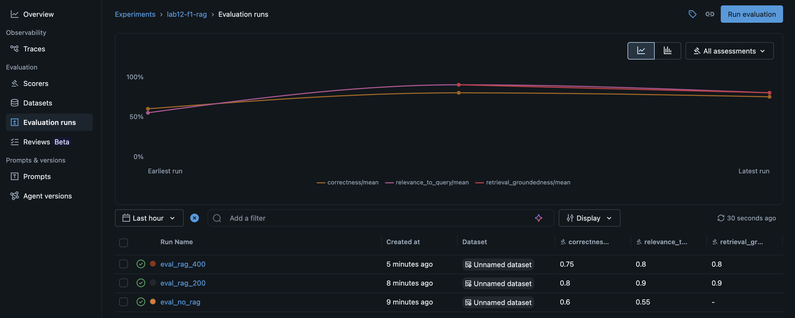
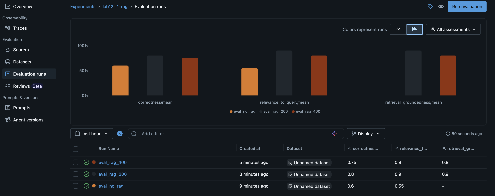


---

## Discussion
**RAG vs prompting.** The LLM only knows its training data and gives no sources. RAG adds current facts at question time and makes answers checkable. 

**Chunk size.** Small chunks match more precisely but lose context and double embedding cost; large chunks give more context but more noise and prompt tokens. 

**Governance and cost.** All data, the index and logs are UC objects with grants, every request is traced. Cost comes from embeddings (once, then incremental), the Vector Search endpoint (billed while running) and LLM tokens (RAG adds context to every prompt). Controls: triggered sync, no LLM call without context, `max_tokens`, deleting the endpoint after use.

---

# Part B - AI-Assisted Development

Part A was built by hand. In Part B, Claude Code with the **Databricks AI Dev Kit** packaged it into an Asset Bundle, added tests and CI/CD, and deployed the assistant as a serving endpoint.

## Setup
- **Skills:** `install.sh` from [ai-dev-kit](https://github.com/databricks-solutions/ai-dev-kit), project scope, profiles *Data Engineer* + *AI/ML Engineer* (not all 40 skills — less noise for the agent).
- **MCP server:** installed separately with `databricks-mcp-server/mcp_install.sh --tools claude --profile uni_free`. It writes `.mcp.json` with local paths, so the file is git-ignored.
  On macOS the dependency `plutoprint` (PDF generation, not needed here) failed to build, so it was excluded with a uv override.

The agent inspected Unity Catalog through MCP:

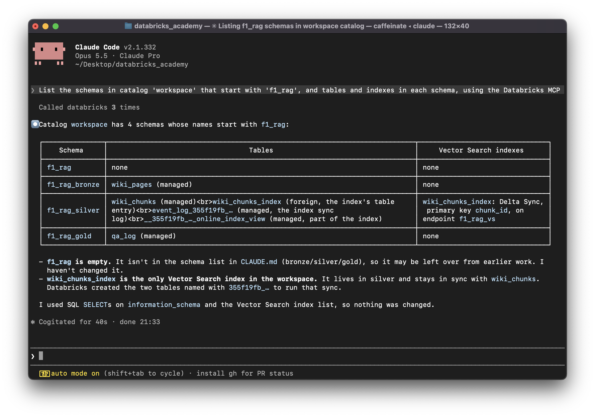

## What the agent built

| Component | Files | Human check |
|---|---|---|
| Refresh job: ingest → chunk → index sync | `databricks.yml`, `resources/refresh_job.yml` | widget parameters, task order, `rag/` synced with notebooks |
| Unit tests (29) | `tests/test_chunking.py`, `pytest.ini` | tests assert behaviour, not just calls |
| Agent for serving | `agent/agent.py`, `notebooks/06_log_agent.py` | `rag/` packaged, resources declared, no tokens |
| Serving endpoint + register job | `resources/agent_endpoint.yml`, `resources/register_agent_job.yml` | CPU Small, scale to zero |
| CI/CD | `.github/workflows/lab12.yml` | secrets only from GitHub, deploy only from `master` |

Every task started in **plan mode**: the agent read the code and proposed a plan, and code was written only after the plan was approved.

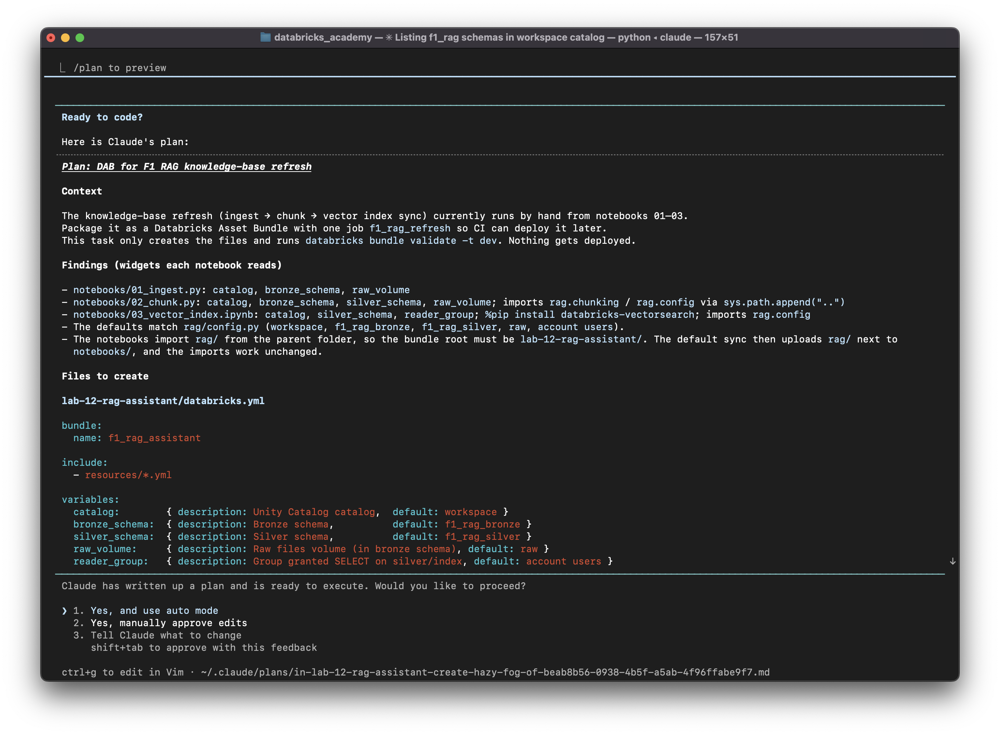
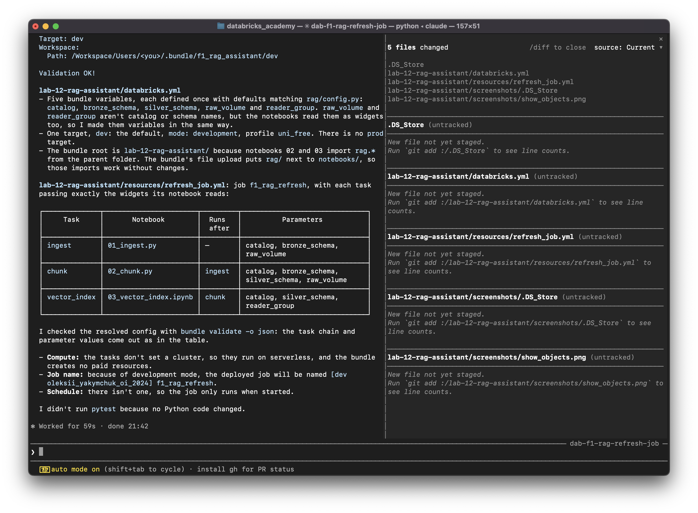

The refresh job deployed by the bundle, started by the agent through MCP:

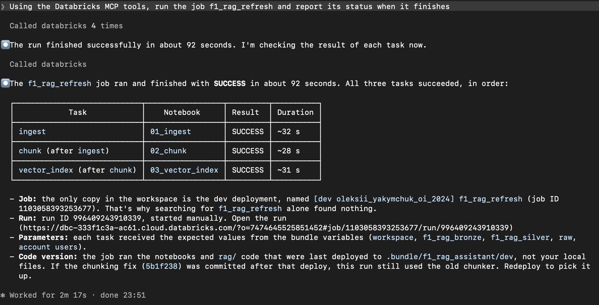
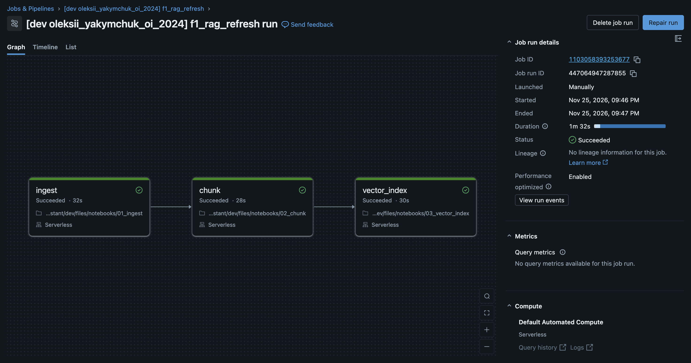

The deployed agent — the endpoint in AI Playground and its trace (`predict → ask → vector_search → LLM`):

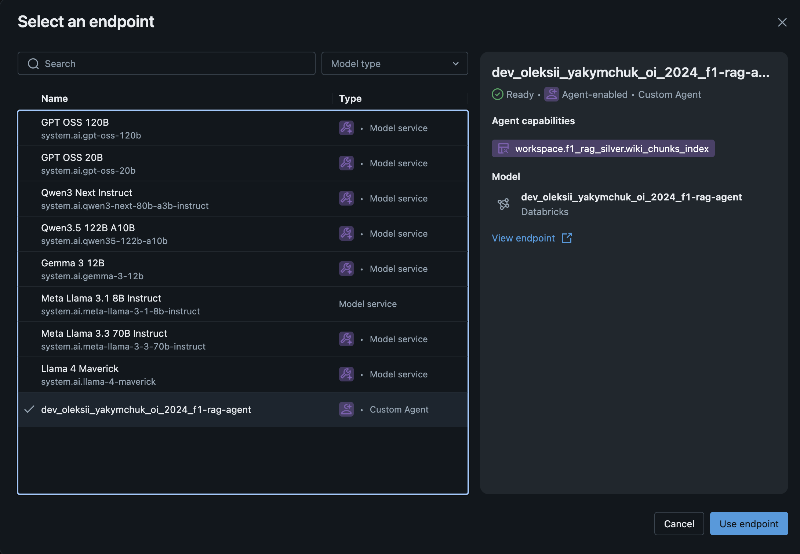
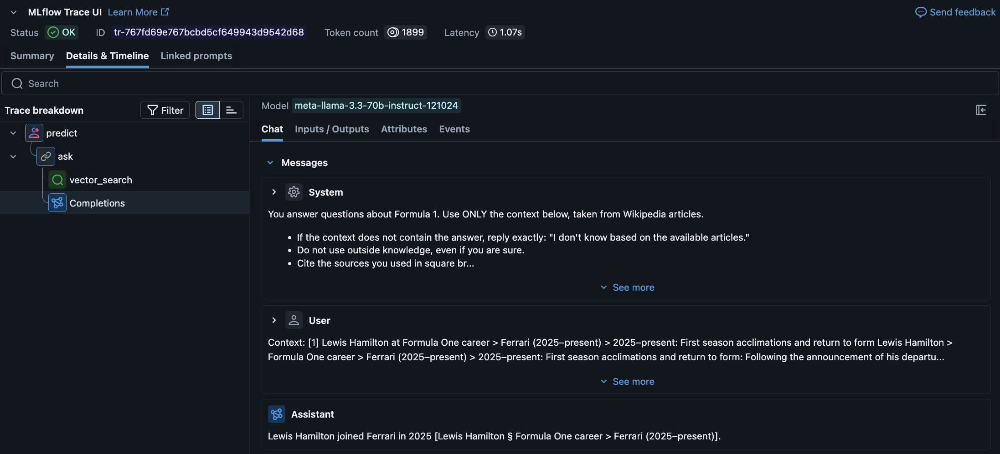
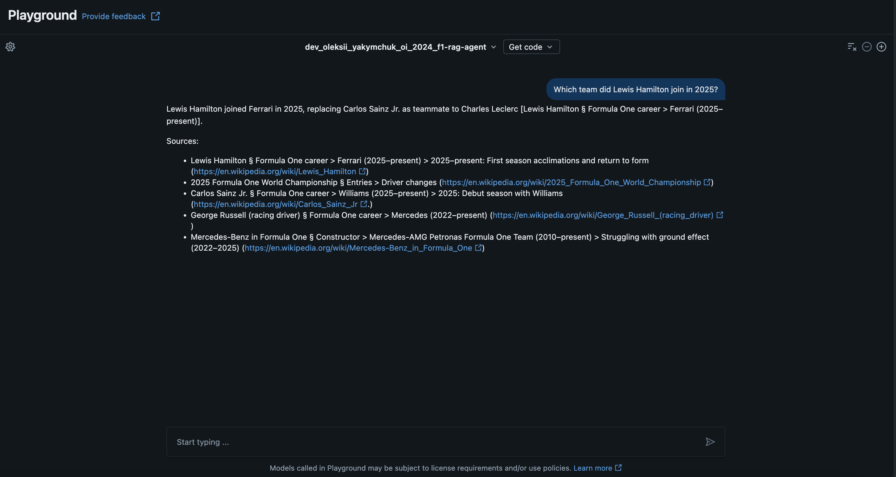

## Delivery flow

```
agent branch ─PR─▶ lab-12 ─PR─▶ master ─▶ bundle deploy (CI)
               tests + validate      tests + validate
```

- **Pull request:** `pytest` and `databricks bundle validate -t dev`.
- **Push to `master`:** tests, then `databricks bundle deploy -t dev`.
- **New agent version:** run `f1_rag_register_agent` → set `agent_model_version` in the bundle → PR → CI deploys the endpoint.

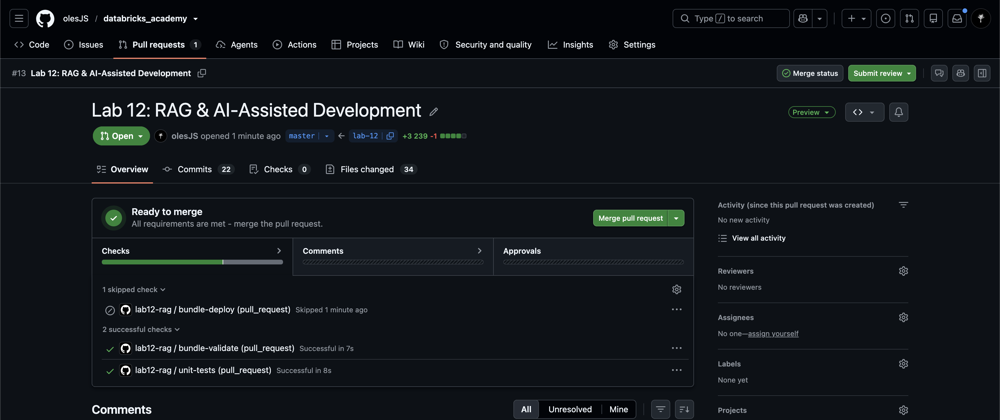
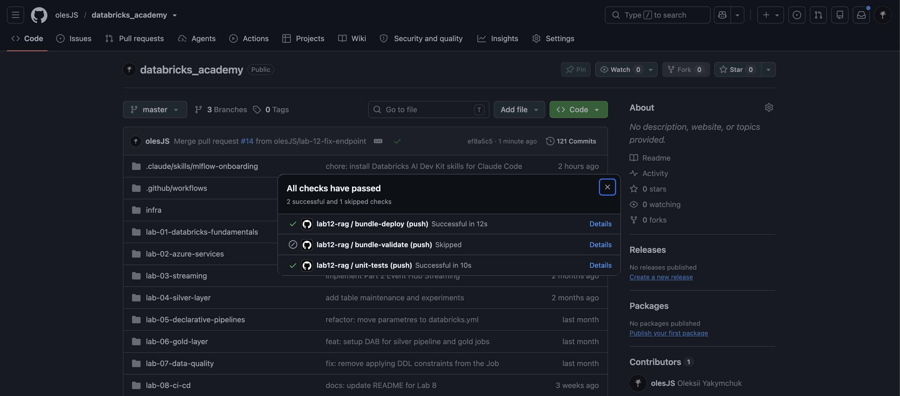

## Guardrails
- **`CLAUDE.md`:** scope (only `lab-12-rag-assistant/` and workflows), dev target only, read-only SQL by default, no dropping objects, no paid resources without asking, never read secrets or `~/.databrickscfg`.
- **Plan mode:** a human approves the plan before any code is written.
- **The agent never deploys:** deployment happens only in CI after a PR is merged.
- **PR + CI gate:** every change of the agent goes through review, tests and `bundle validate`.
- **Secrets:** the CI token lives only in GitHub Actions secrets. The token is personal (PAT) — fine for the lab; in production a service principal with minimal rights.
- **Least privilege for the endpoint:** it reads the index and the LLM endpoints through resources declared when the model is logged — no tokens in code.

## Reflection

**Where the agent accelerated work**
- Bundle, tests, agent wrapper and CI workflow were ready in minutes; it checked the notebooks' widgets itself and matched the job parameters to them.
- During review it found two real bugs: chunks could exceed `max_tokens` after overlap (a failing test), and a typo (`promp_tokens`) that silently logged 0 prompt tokens.
- It reported problems instead of fixing them silently.

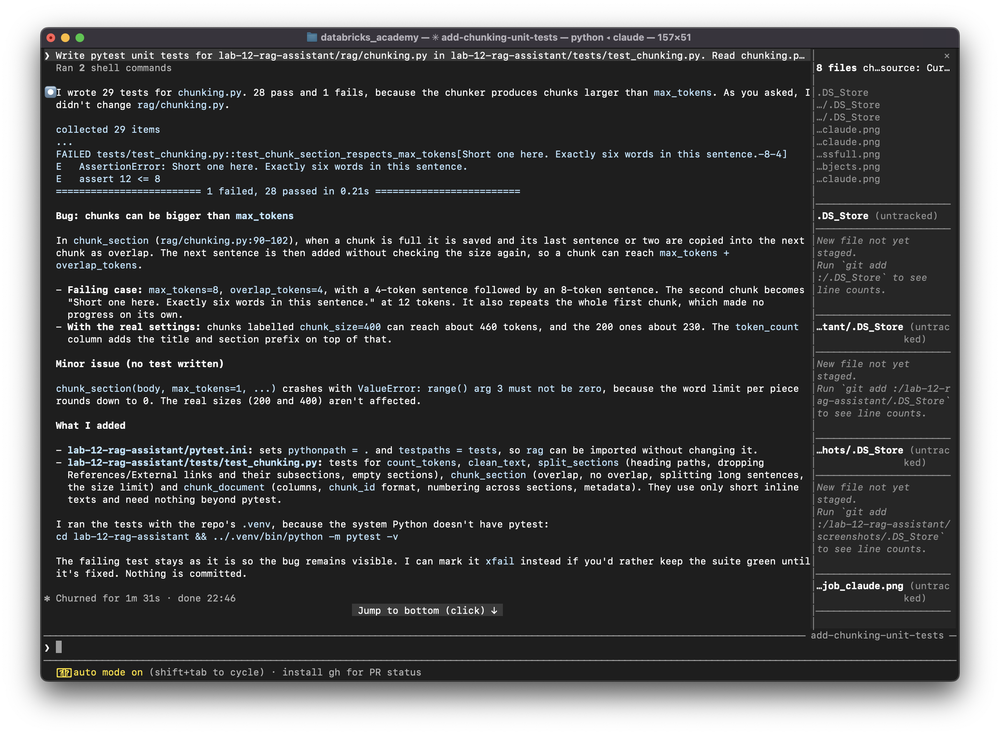

**Where human review was essential**
- **Correctness:** the chunking bug was fixed by me; the impact on chunks already in silver was checked separately.
- **Platform limits:** the agent configured inference tables (best practice), but they are not supported on Free Edition. The first deploy passed silently; CI failed on the next update (`FEATURE_DISABLED`), and the fix went through the same PR → CI flow.
- **Environment:** the agent's CI plan assumed only one CLI profile matched the workspace URL; locally two did. It corrected the plan itself and did not touch `~/.databrickscfg`, as `CLAUDE.md` requires.
- **Cost and governance:** endpoint size and scale-to-zero, what the endpoint can access, and where secrets live were decided and checked by me.

AI output went through plans, PRs, tests and CI/CD — nothing was deployed blindly.