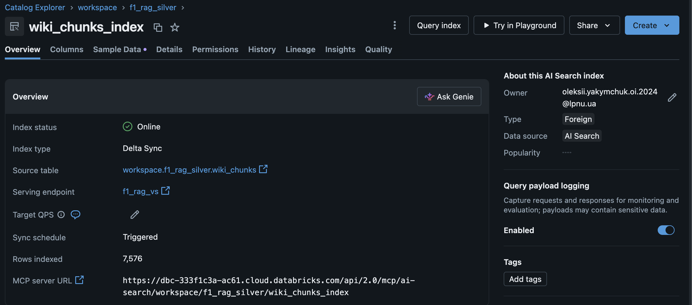
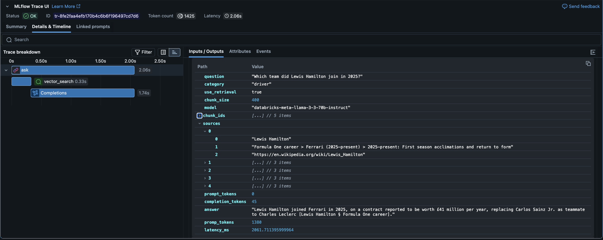
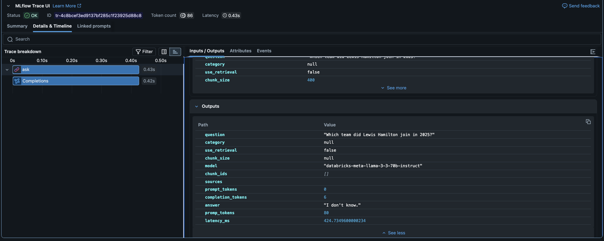
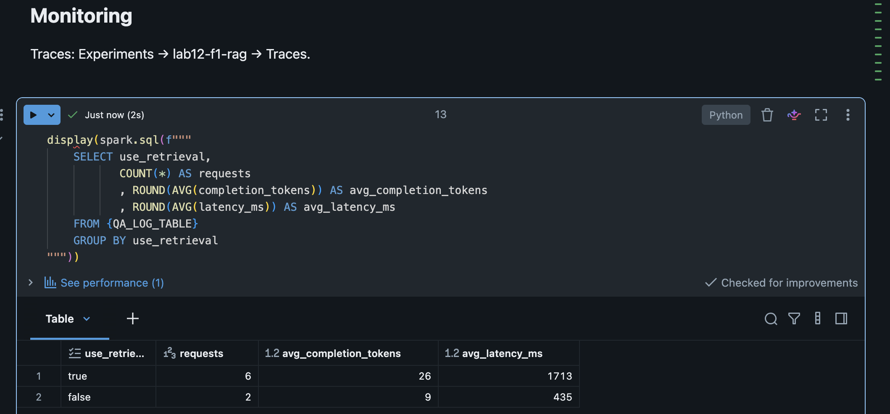
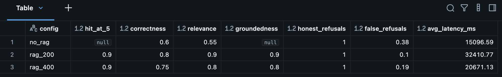

# Lab 12 - RAG Knowledge Assistant & AI-Assisted Development

A knowledge assistant that answers questions about **Formula 1** from 86 English Wikipedia articles.
- Part A: RAG pipeline on Databricks. 
- Part B: packaging and deployment with an AI coding agent.

```
Wikipedia API ─▶ UC Volume (JSON) ─Auto Loader─▶ bronze.wiki_pages
   ─chunking + MERGE─▶ silver.wiki_chunks ─Delta Sync─▶ Vector Search index
   ─▶ ask(): retrieve → LLM → answer + sources ─▶ gold.qa_log + MLflow traces
```

| Path | Content |
|---|---|
| `scripts/fetch_wiki.py` | Fetch articles, upload to UC Volume |
| `rag/` | `config.py`, `chunking.py`, `qa.py` (`retrieve()`, `ask()`) |
| `notebooks/00–05` | Setup, ingest, chunk, index, QA, evaluation |
| `eval/questions.json` | 20 answerable + 4 unanswerable questions |

---

# Part A - RAG on Databricks

## 1. Data
86 Wikipedia articles: 40 drivers, 10 teams, 24 circuits, 6 seasons (2020–2025), 6 general.
`fetch_wiki.py` uploads one JSON per article revision to a Volume; `01_ingest.py` loads new files into append-only bronze with **Auto Loader**.


## 2. Cleaning and chunking
- Drop sections without content (*References*, *External links*, ...), normalize whitespace.
- Split by sections, then into ~200 and ~400-token chunks with ~15% overlap.
- Prefix every chunk with `Title > Section:` so it keeps its context.
- Metadata: `chunk_id`, `chunk_size`, `title`, `category`, `section`, `url`, `revision_id`.

`02_chunk.py` processes only new bronze rows and `MERGE`s on the deterministic `chunk_id`; stale chunks of updated articles are deleted.


## 3. Embeddings and Vector Search
- Delta Sync index with managed embeddings (`databricks-gte-large-en`, 1024 dims); chunks stay below its 512-token limit.
- TRIGGERED sync via Change Data Feed — only changed chunks are re-embedded.
- 7,576 chunks; initial sync took ~2 h (~1 row/s embedding throughput on Free Edition).



## 4. Retrieval and QA
- `retrieve()`: hybrid search (vectors + keywords), top-5, optional `category` filter.
- `ask()`: context labelled `[Title § Section]` → LLM (`temperature=0`) → answer + sources.
- Prompt rules: answer **only** from context, cite sources, otherwise reply *"I don't know based on the available articles."*
- `use_retrieval=False` — same LLM without context, used as a baseline.






## 5. Monitoring and security
- **MLflow traces:** `ask` → `vector_search` → LLM call, with chunks, prompt, tokens, latency.
- **`gold.qa_log`:** every request (question, mode, chunk ids, answer, tokens, latency) for SQL monitoring.
- **Unity Catalog grants:** readers get `SELECT` on silver chunks and the index only; raw data and the QA log (user questions) are closed.




## 6. Evaluation
Three configs — `no_rag`, `rag_200`, `rag_400` — on 20 answerable questions (well-known facts + 2024–2025 events) and 4 unanswerable ones.
LLM judges run on answerable questions only; refusals are measured separately.




---

## Discussion
**RAG vs prompting.** The LLM only knows its training data and gives no sources. RAG adds current facts at question time and makes answers checkable. 

**Chunk size.** Small chunks match more precisely but lose context and double embedding cost; large chunks give more context but more noise and prompt tokens. 

**Governance and cost.** All data, the index and logs are UC objects with grants, every request is traced. Cost comes from embeddings (once, then incremental), the Vector Search endpoint (billed while running) and LLM tokens (RAG adds context to every prompt). Controls: triggered sync, no LLM call without context, `max_tokens`, deleting the endpoint after use.

---

# Part B - AI-Assisted Development

In progress.